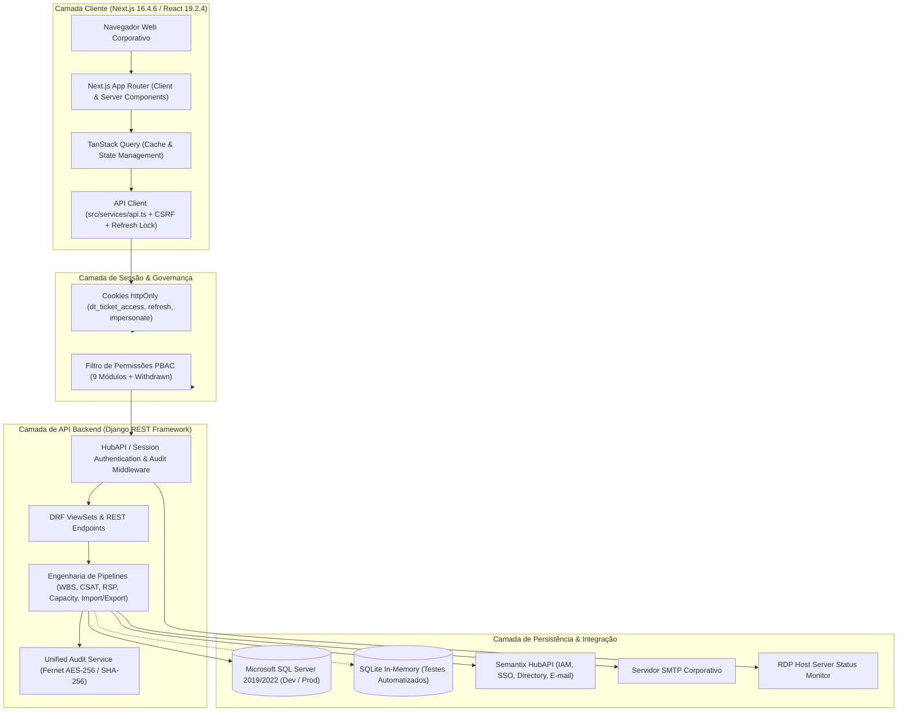
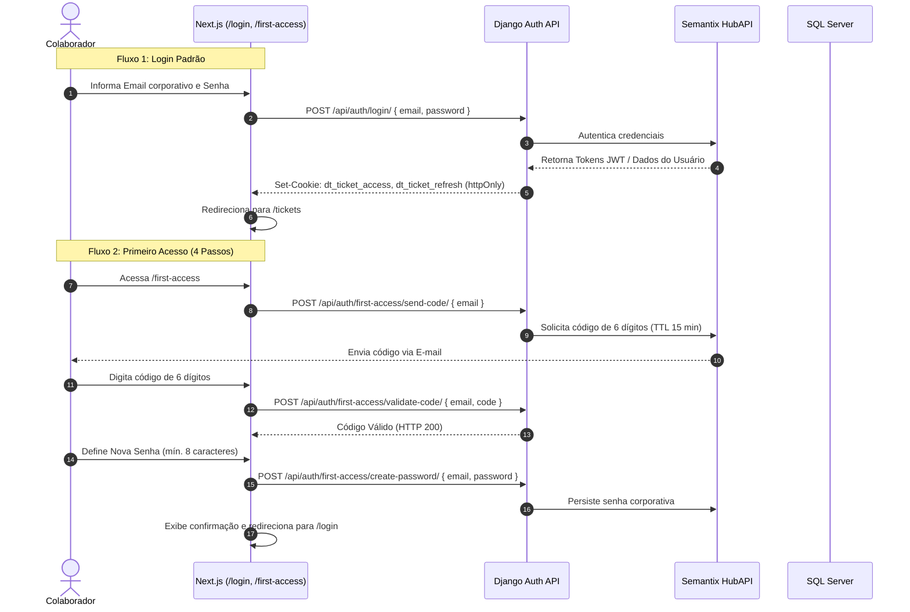
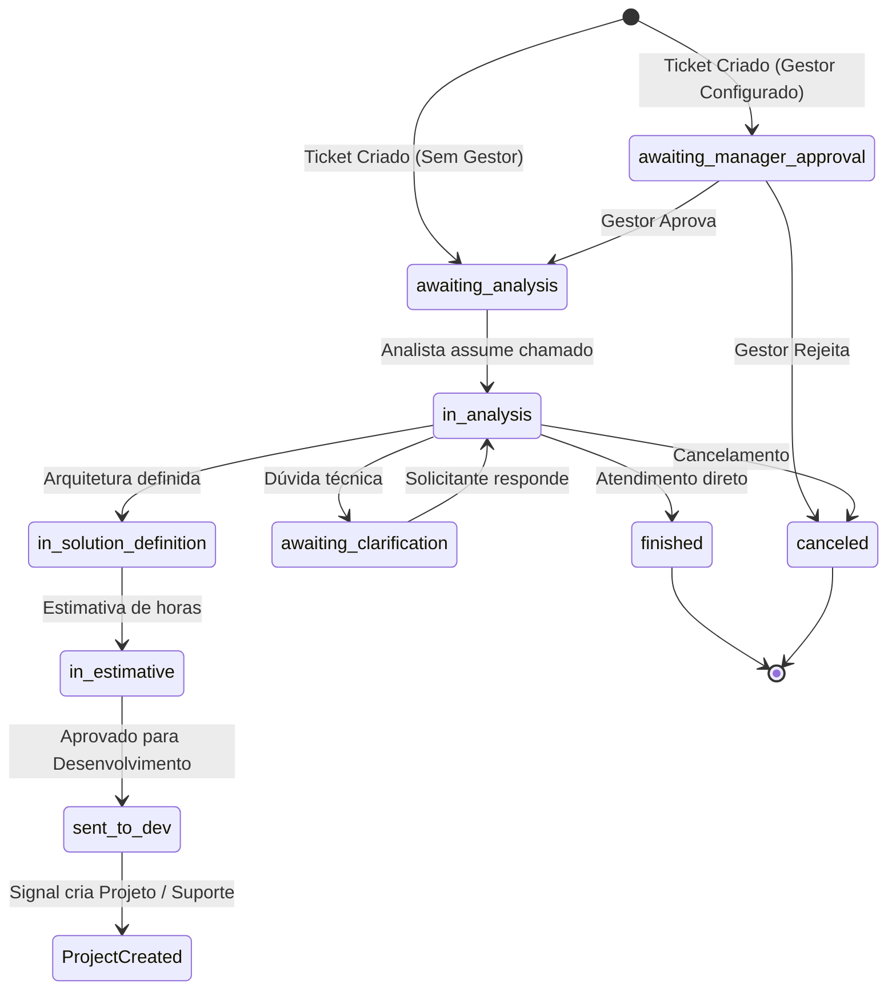
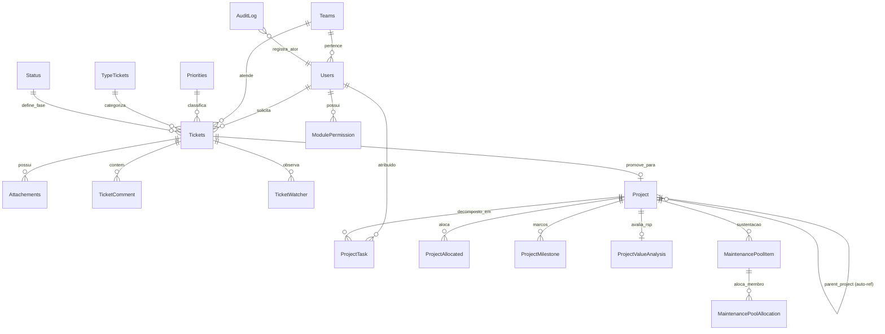
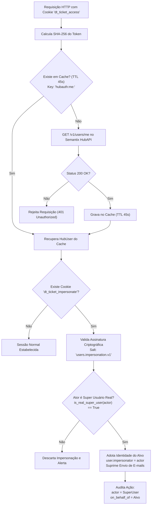

# Base Técnica MeTRIX — Índice Técnico de Arquitetura Fundamental

> **Documento Canônico de Arquitetura Técnica, Inventário de Dados e Baseline de Cobertura de Testes**  
> **Status:** Canônico / Especificação Arquitetural de Engenharia  
> **Versão:** 2.0 (Fase 1 Verificada)  
> **Classificação:** Uso Interno Corporativo / Engenharia de Software  

---

## SUMÁRIO GERAL

1. [Visão Geral do Sistema e Arquitetura de Alto Nível](#1-visão-geral-do-sistema-e-arquitetura-de-alto-nível)
   - 1.1 Stack Tecnológica e Versões Homologadas
   - 1.2 Topologia de Integrações Externas
   - 1.3 Camada de Governança, Sessão e Criptografia
   - 1.4 Diagrama Arquitetural de Alto Nível
2. [Índice Canônico dos 9 Módulos do Sistema e Motores Transversais](#2-índice-canônico-dos-9-módulos-do-sistema-e-motores-transversais)
   - 2.1 Catálogo dos 9 Módulos Canônicos do PBAC
   - 2.2 Modificador de Exceção: Withdrawn (Revogação Instantânea Total)
   - 2.3 Motores Transversais do Sistema
3. [Arquitetura de Fluxo do Usuário (User Flow)](#3-arquitetura-de-fluxo-do-usuário-user-flow)
   - 3.1 Autenticação, Onboarding e Segurança de Acesso
   - 3.2 Área de Trabalho Operacional e Tarefas
   - 3.3 Ciclo de Vida de Chamados (Tickets)
   - 3.4 Avaliação de Satisfação (CSAT) e Perfil de Acesso
4. [Arquitetura de Fluxo do Gestor e Administrador (Manager Flow)](#4-arquitetura-de-fluxo-do-gestor-e-administrador-manager-flow)
   - 4.1 Triagem Operacional e Monitoramento em Tempo Real
   - 4.2 Visão Executiva Estratégica e Consolidação Hierárquica WBS
   - 4.3 Gestão Avançada de Portfólio de Projetos
   - 4.4 Centro de Suporte Técnico e SLA
   - 4.5 Gestão Financeira de Valor (RSP) e Capacity Planning
   - 4.6 Governança Central, Configurações e Auditoria Forense
   - 4.7 Portais de Aprovação Pública Tokenizada (1-Clique)
5. [Inventário Completo de Esquemas de Banco de Dados e Modelos (35 Modelos)](#5-inventário-completo-de-esquemas-de-banco-de-dados-e-modelos-35-modelos)
   - 5.1 Modelos do App `users` (4 Modelos)
   - 5.2 Modelos do App `notifications` (2 Modelos)
   - 5.3 Modelos do App `tickets` (29 Modelos)
   - 5.4 Matriz Comparativa: SQL Server (Dev/Prod) vs SQLite (Testes em Memória)
6. [Engenharia de Pipelines Críticos](#6-engenharia-de-pipelines-críticos)
   - 6.1 Pipeline 1: Autenticação, Semantix Hub IAM, Cache SHA-256 e Impersonação
   - 6.2 Pipeline 2: Ciclo do Ticket, Promoção Automática e Motor CSAT Tokenizado
   - 6.3 Pipeline 3: Hierarquia WBS, Árvore de Projetos e Importação Excel com Kahn
   - 6.4 Pipeline 4: Aprovações Tokenizadas HMAC-SHA256 (1-Clique)
   - 6.5 Pipeline 5: Capacity Planning, Maintenance Pool e Regras MyAPS
   - 6.6 Pipeline 6: Catálogo e Despacho Assíncrono de Notificações (27 Eventos)
   - 6.7 Pipeline 7: Governança PBAC e Trilha de Auditoria Forense AES-256
7. [Matriz Base de Cobertura de Testes e Roteiro Meta 100%](#7-matriz-base-de-cobertura-de-testes-e-roteiro-meta-100)
   - 7.1 Baseline da Suíte Backend (44 Arquivos / 812 Testes)
   - 7.2 Lacunas Mapeadas do Backend
   - 7.3 Baseline da Suíte Frontend (31 Arquivos / 584 Testes)
   - 7.4 Lacunas Mapeadas do Frontend
   - 7.5 Matriz Consolidada de Cobertura de Testes
   - 7.6 Roadmap Estruturado de Engenharia para Meta de 100% de Cobertura

---

## 1. VISÃO GERAL DO SISTEMA E ARQUITETURA DE ALTO NÍVEL

O **DT-GESTAO-TICKET** é uma plataforma corporativa integrada de governança, sustentação de sistemas, alocação de capacidade operacional, gestão de projetos e acompanhamento de retorno financeiro (RSP — Retorno Sobre Projetos). A solução foi concebida para operar em topologias corporativas de alta segurança, oferecendo paridade entre operações de atendimento a chamados (Service Desk) e governança executiva de portfólio.

### 1.1 Stack Tecnológica e Versões Homologadas

A arquitetura adota um desacoplamento estrito entre o cliente web moderno e a API RESTful de alta performance:

| Camada | Tecnologia / Framework | Versão Homologada | Papel Arquitetural / Justificativa de Engenharia |
|---|---|---|---|
| **Frontend Runtime** | **Next.js** (App Router) | **16.4.6** | Framework React full-stack com SSR/SSG híbrido, otimização de rotas e proxy reverso integrado. |
| **UI Library** | **React** | **19.2.4** | Biblioteca declarativa de interfaces reativas, componentes concorrentes e actions assíncronas. |
| **Client State / Cache** | **TanStack Query** (React Query) | **v5.101.4** | Gestão de cache assíncrono, mutações otimistas, deduplicação de requisições e pooling operacional. |
| **Design System / CSS** | **Tailwind CSS** | **v4** | Motor de estilização atômica utility-first de alta densidade sem overhead de CSS em tempo de execução. |
| **Frontend Testing** | **Node Native Test Runner** (`tsx --test`) | **Node 20+ / tsx** | Execução ultrarrápida de testes unitários TypeScript (1.64s para 584 testes) sem bundling pesado. |
| **Backend Framework** | **Django REST Framework** (DRF) | **Django 5.x / DRF 3.x** | Camada corporativa de endpoints RESTful com validação via serializers, viewsets desacopladas e signals. |
| **Database Engine (Prod)** | **Microsoft SQL Server** | **2019 / 2022** | RDBMS transacional legado/corporativo com integridade referencial estrita e mapeamento físico de colunas. |
| **Database Driver (Prod)** | **mssql-django / pyodbc** | **ODBC Driver 17** | Conector nativo de alto desempenho via C++/ODBC com suporte a transações distribuídas e parâmetros seguros. |
| **Database Engine (Test)** | **SQLite In-Memory** | **3.8+ (`:memory:`)** | Banco relacional volátil em RAM para isolamento de suíte de testes com zero persistência e execução em 20s. |

### 1.2 Topologia de Integrações Externas

1. **Semantix HubAPI (IAM / SSO / Directory / E-mail):**
   - **Autenticação e SSO:** Provedor central de identidade corporativa (OpenID Connect / OAuth2). Emissão de access tokens e refresh tokens.
   - **Diretório Corporativo:** Sincronização em tempo real de colaboradores (`HubUser`), cargos, DAS codes, e-mails corporativos e estruturas organizacionais.
   - **Motor Transacional de E-mail:** Envio de e-mails via HTTP REST (`POST /notifications/send-email`) integrado à infraestrutura corporativa do Semantix Hub.
2. **SMTP Corporativo / Fallback:**
   - Barramento padrão para envio direto de notificações em caso de contingência ou para execução em ambientes legados.
3. **RDP Host Server Session Status:**
   - Monitoramento em tempo real do estado de conexões remotas (`free`, `occupied_active`, `occupied_idle`, `disconnected`) no servidor Windows de hospedagem, prevenindo conflitos durante pipelines de build e deploy de novas releases.

### 1.3 Camada de Governança, Sessão e Criptografia

- **PBAC (Policy/Permission-Based Access Control):** Controle granular de acesso estruturado sobre 9 módulos canônicos, associando cada usuário aos privilégios de visualização ("Apenas Ver") ou modificação ("Edição"), com barreiras estritas contra auto-bloqueio.
- **Cookies de Sessão httpOnly:**
  - `dt_ticket_access`: JWT de acesso com validade de 900s (15 minutos), flags `httpOnly`, `SameSite=Lax`, e `Secure` em produção.
  - `dt_ticket_refresh`: Token de atualização com validade de 8 horas, restrito ao endpoint `/api/auth/refresh/`.
  - `dt_ticket_impersonate`: Cookie de sessão de impersonação ("Ver Como"), assinado criptograficamente via `django.core.signing.dumps` com salt `users.impersonation.v1` e TTL de 3600 segundos.
  - *Mitigação XSS:* A proibição de persistência de tokens em `localStorage` impede que scripts maliciosos ou aplicações compartilhando a mesma origem (`/dt-ticket`, `/dt-wbs`) acessem os tokens da sessão.
- **CSRF Estrito:**
  - Todas as chamadas de mutação HTTP (`POST`, `PUT`, `PATCH`, `DELETE`) sem cabeçalho `Authorization` exigem a validação cruzada do token `dt_ticket_csrftoken` injetado no header `X-CSRFToken` via método `_enforce_csrf`.
- **Criptografia Simétrica em Repouso (Fernet AES-256):**
  - Dados sensíveis e metadados de auditoria forense são encriptados no banco de dados (`audit_logs.encrypted_payload`) usando algoritmo Fernet (AES-256-CBC com autenticação HMAC-SHA256).
- **Integridade Forense (Hashing SHA-256):**
  - Todo upload de anexo de chamado, projeto, tarefa ou comentário é submetido a cálculo de hash SHA-256, garantindo não-repúdio e rastreabilidade total no log de auditoria.

### 1.4 Diagrama Arquitetural de Alto Nível



---

## 2. ÍNDICE CANÔNICO DOS 9 MÓDULOS DO SISTEMA E MOTORES TRANSVERSAIS

O controle de acesso e funcionalidade do DT-GESTAO-TICKET é estruturado formalmente em **9 Módulos Canônicos** governados pela tabela `module_permissions`, acrescidos de um modificador de revogação de emergência e quatro motores transversais.

### 2.1 Catálogo dos 9 Módulos Canônicos do PBAC

```
+---------------------------------------------------------------------------------------------------+
|                            MATRIZ CANÔNICA DE GOVERNANÇA PBAC (9 MÓDULOS)                         |
+---+----------------------+-----------------------------+------------------------------------------+
| # | Identificador Único  | Nome Formal na Interface    | Escopo Operacional e Responsabilidades   |
+---+----------------------+-----------------------------+------------------------------------------+
| 1 | gestao_tickets       | Gestão de Tickets           | Triagem, ciclo de vida de chamados,      |
|   |                      |                             | observadores, SLAs e transições.         |
| 2 | gestao_projetos      | Gestão de Projetos          | Portfólio de projetos, tarefas, WBS,     |
|   |                      |                             | alocações, marcos e guarda-chuva.        |
| 3 | gestao_suporte       | Gestão de Suporte           | Chamados de sustentação técnica, SLA     |
|   |                      |                             | operacional e pesquisa CSAT tokenizada.  |
| 4 | gestao_valor         | Gestão de Valor (RSP)       | Análise de Retorno Sobre Projetos, ROI,  |
|   |                      |                             | Payback, Saving Anual e tabela GCM.      |
| 5 | gestao_capacity      | Capacity & Sustentação      | Planejamento de capacidade, horas-meta,  |
|   |                      |                             | Maintenance Pool e relatórios MyAPS.     |
| 6 | configuracoes        | Configurações de Acesso     | Matriz 2D de PBAC, catálogo de e-mails,  |
|   |                      |                             | auditoria forense e importação Excel.    |
| 7 | super_user           | Super Usuários              | Privilégios globais irrestritos, sessões |
|   |                      |                             | RDP e modo de impersonação ("Ver Como"). |
| 8 | desenvolvedores      | Desenvolvedores             | Visão operacional de tarefas atribuídas, |
|   |                      |                             | apontamentos de horas e submissões.      |
| 9 | gestao_gerencial     | Visão Gerencial             | Visão consolidada de portfólio, top 5    |
|   |                      |                             | KPIs executivos e árvore hierárquica WBS.|
+---+----------------------+-----------------------------+------------------------------------------+
```

1. **`gestao_tickets`:** Governa o fluxo operacional de solicitações abertas por colaboradores, permitindo triagem gerencial, reatribuição de equipes, priorização, avanço de fases de análise e promoção automática para projetos de desenvolvimento.
2. **`gestao_projetos`:** Centraliza a administração do ciclo de desenvolvimento de software e iniciativas estratégicas. Suporta projetos-pai (guarda-chuva/umbrella), subprojetos associados, cadastro de tarefas com workflow de submissão, painel de desenvolvedores alocados e controle de marcos contratuais (*milestones*).
3. **`gestao_suporte`:** Canal especializado para atendimento de incidentes e sustentação contínua. Opera integrado ao modelo de satisfação do cliente (CSAT), gerando métricas consolidadas de qualidade técnica.
4. **`gestao_valor`:** Módulo executivo focado em Engenharia de Valor (RSP — Retorno Sobre Projetos). Modela os tópicos financeiros oficiais da organização: Produtividade (Tópico 2), Ganhos Operacionais e Redução de Erros (Tópico 3), Economia Direta e Evitação de Custos (Tópico 4) e Despesas com Licenças e Terceiros (Tópico 5). Calcula Saving Total, Custo de Desenvolvimento de 1º Ano, Benefício Líquido, ROI percentual e Payback em meses.
5. **`gestao_capacity`:** Instrumento de planejamento e alocação da força de trabalho. Controla as cotas de horas contratadas e disponíveis por colaborador em cada competência (`YYYY-MM`), compara horas em projetos externos contra WBS internas, gerencia pacotes recorrentes de sustentação (*Maintenance Pool*) com prevenção transacional de estouro de cota e emite ordens de apropriação MyAPS.
6. **`configuracoes`:** Painel de controle corporativo restrito aos administradores. Reúne a Matriz de Acessos bidimensional, gestão de triggers e destinatários de 27 eventos de notificação, visualizador de logs de auditoria forense, mapas de calor (*heatmaps*) de telemetria e o pipeline de importação e exportação em massa de planilhas de projetos com validação topológica.
7. **`super_user`:** Privilégio de auditoria e intervenção máxima no sistema. Concede bypass total sobre regras de autorização de leitura e escrita, acesso à telemetria de infraestrutura RDP do servidor Windows e ativação da funcionalidade de impersonação ("Ver Como"), que permite reproduzir o contexto de tela exato de qualquer colaborador corporativo.
8. **`desenvolvedores`:** Módulo de interface simplificada e direta destinado aos membros da equipe técnica. Garante acesso à área `/minhas-tarefas`, permitindo visualizar backlog individual, transicionar tarefas para revisão, anexar evidências de homologação e solicitar aprovação formal de conclusão ao líder técnico.
9. **`gestao_gerencial`:** Dashboard de consolidação executiva. Agrega os 5 principais indicadores corporativos (Saving, FTEs, Custos, Benefício Líquido, ROI) em árvore hierárquica WBS navegável, viabilizando a análise isolada de iniciativas independentes versus iniciativas filhas agrupadas sob o mesmo orçamento.

### 2.2 Modificador de Exceção: Withdrawn (Revogação Instantânea Total)

O sistema implementa uma salvaguarda jurídica e de segurança da informação materializada pelo valor canônico `withdrawn` no campo `module_permissions.module`.

- **Mecânica de Bloqueio Instantâneo:** Ao marcar um colaborador como `withdrawn`, uma transação atômica apaga todas as linhas ativas de privilégios (`module_permissions`) pertencentes àquele e-mail e gera um registro em `withdrawn_permission_snapshots`.
- **Preservação de Snapshot (`WithdrawnPermissionSnapshot`):** O snapshot serializa a lista integral de permissões anteriores em formato JSON estruturado (`snapshot_json`), armazenando o e-mail do autor da revogação e o carimbo de data/hora (`withdrawn_at`).
- **Restauração 100% Íntegra:** Caso o status seja desbloqueado pelo administrador, o motor de governança lê o snapshot histórico e restabelece atomicamente as linhas exatas de acesso originais (incluindo o status `can_edit`), registrando a reintegração na trilha de auditoria forense.

### 2.3 Motores Transversais do Sistema

1. **Motor de Autenticação, Diretório e Equivalência de E-mails:**  
   Resolve dinamicamente conflitos de identidade corporativa unificando as três ramificações corporativas homologadas: `@atos.net`, `@atos.ai` e `@semantix.ai`. O motor normaliza todos os registros para o domínio canônico único `@atos.net`, assegurando que logins, permissões PBAC, observadores de tickets e alocações de tarefas convirjam para a mesma entidade lógica no banco de dados.
2. **Motor de Aprovações Tokenizadas (1-Clique via E-mail):**  
   Gera payloads assinados com tecnologia HMAC-SHA256 codificados em URL-safe base64, com prazo de expiração estrito de 7 dias. Permite que gestores e responsáveis aprovem solicitações de tickets (`/aprovar/[token]`) ou homologuem tarefas técnicas concluídas (`/aprovar-tarefa/[token]`) diretamente a partir de botões em seus clientes de e-mail corporativos, dispensando autenticação prévia na interface.
3. **Motor de Notificações Assíncronas (27 Eventos no Catálogo):**  
   Barramento pub/sub desacoplado que opera via threads isoladas em segundo plano (`ContextThread`). Possui matriz de roteamento para 5 papéis dinâmicos (Solicitante, Observador, Atribuído, Gestor de Módulo, Superusuário), deduplicação estrita de e-mails corporativos, salvaguardas de homologação e supressão automática durante sessões de impersonação.
4. **Pipeline de Importação/Exportação Excel com Ordenação Topológica de Kahn:**  
   Mecanismo de carga de dados em massa que interpreta grafos acíclicos dirigidos (DAGs) de projetos e subprojetos em planilhas Excel. Implementa o algoritmo de Kahn para ordenar a persistência hierárquica garantindo que entidades-pai sejam commitadas antes de entidades-filhas, associado a triplo loop de detecção de referências circulares e controle de concorrência por hash criptográfico de estado (`compute_import_state_hash`).

---

## 3. ARQUITETURA DE FLUXO DO USUÁRIO (USER FLOW)

O fluxo do usuário comum é desenhado para guiar solicitantes e membros de equipe técnica de forma clara, garantindo integridade de dados e validações em tempo de digitação.

### 3.1 Autenticação, Onboarding e Segurança de Acesso



- **`/login` (`src/app/login/page.tsx`):**
  - Campos de entrada: E-mail corporativo e senha com alternador de visibilidade (`Eye`/`EyeOff`).
  - Ações: Submissão para `POST /api/auth/login/`. Sucesso (`200`) hidrata o `AuthContext` com a entidade do usuário e grava os cookies de sessão `httpOnly`, disparando `router.push("/tickets")`.
  - Desvio de Primeiro Acesso: Caso a API retorne `{ success: false, reason: "first_access_required" }`, o sistema redireciona automaticamente para `/first-access?email=...`.
  - Tratamento de Falha (`401`): Ativa animação CSS `animate-shake` no card e exibe mensagem de advertência clara. Disponibiliza link de download do documento de suporte `Guia_DT_Gestao_Tickets.pdf`.
- **`/first-access` (`src/app/first-access/page.tsx` & `CodeFlowForm.tsx`):**
  - Operação em máquina de estados finitos (FSM) de 4 etapas:
    1. `email`: Validação de domínio corporativo e disparo de `POST /api/auth/first-access/send-code/`.
    2. `code`: Campo numérico de 6 dígitos com expiração de 15 minutos e reenvio condicional, validado via `POST /api/auth/first-access/validate-code/`.
    3. `password`: Definição de senha com indicador de força e confirmação de segurança (mínimo de 8 caracteres), enviada a `POST /api/auth/first-access/create-password/`.
    4. `done`: Tela de encerramento de fluxo com botão de acesso direto ao login.
  - Mapeamento Semântico de Erros: `PASSWORD_ALREADY_SET`, `NO_APPLICATION_ACCESS`, `EMPLOYEE_NOT_FOUND`, `APPLICATION_NOT_FOUND`, `INVALID_CODE` e `HUB_UNAVAILABLE`.
- **`/forgot-password` (`src/app/forgot-password/page.tsx` & `CodeFlowForm.tsx`):**
  - Submissão para `POST /api/auth/forgot-password/` adotando política de **anti-enumeração de usuários**: o backend sempre responde com HTTP `202 Accepted`, independentemente da existência do e-mail na base corporativa.
  - Inserção do código de verificação recebido e redefinição de credencial via `POST /api/auth/reset-password/`.
- **`/dashboard` (`src/app/(app)/dashboard/page.tsx`):**
  - Rota de atalho que implementa redirecionamento estrito no servidor via `redirect("/tickets")`, padronizando o ponto de entrada de usuários comuns.

### 3.2 Área de Trabalho Operacional e Tarefas

- **`/minhas-tarefas` (`src/app/(app)/minhas-tarefas/page.tsx`):**
  - Gated por `canAccessMyTasks(user)`; usuários sem permissão são interceptados pelo `<AccessDeniedBarrier>`.
  - Consome `GET /api/tickets/my-tasks/` e `GET /api/tickets/my-projects/` com `staleTime` de 30 segundos.
  - Indicadores Operacionais (`computeMyTasksKpis`): Total de Tarefas, Em Andamento, Concluídas, Pendentes de Aprovação, Atrasadas e Projetos sem Tarefas vinculadas. O clique em cada indicador aplica filtro imediato à listagem.
  - Agrupamento Hierárquico: Executa `groupTasksAndProjects` organizando tarefas sob seus respectivos projetos com suporte a paginação incremental (`useClientIncrementalTable`).
  - Ações Rápidas: Clique no card abre `TaskDetailModal`; botão de ação abre `EditTaskModal` para atualização de horas, status ou submissão de homologação.
- **`/minhas-tarefas/[id]` (`src/app/(app)/minhas-tarefas/[id]/page.tsx`):**
  - Visão dedicada de projeto para desenvolvedores alocados e líderes técnicos (`isUserAllocatedOrResponsible`, `canManageOrSubmitTasks`, `filterVisibleTasks`).
  - Cabeçalho detalhado: Nome, Área, Recurso Lead, Prazos e Código WBS (`canUserEditProjectWbs`).
  - Ciclo de Tarefas: `task_open`, `task_doing`, `task_review`, `task_done`, `task_canceled`.
  - Edição Inline de Alta Agilidade: `TaskDateInline`, `TaskHoursInline`, `TaskStatusDropdownInline`, `TaskAssigneeDropdownInline`.
  - Modais Operacionais: Inclusão de tarefa (`AddTaskModal`), edição (`EditTaskModal`), detalhe (`TaskDetailModal`) e tarefas rejeitadas (`RejectedTasksModal`).
  - Central de Aprovação de Conclusão: Cartão `PendingApprovalsCard` e gaveta lateral `PendingTaskDrawer` para conferência de justificativas de encerramento submetidas pelos desenvolvedores.
  - Componentes Auxiliares: Gestão de marcos intermediários (`ProjectMilestones`), painel de alocados (`ProjectAllocatedPanel`), comentários de projeto e histórico de auditoria por calendário.

### 3.3 Ciclo de Vida de Chamados (Tickets)



- **`/tickets` (`src/app/(app)/tickets/page.tsx`):**
  - Tabela principal de chamados alimentada por `GET /api/tickets/` com filtros combinados (`status`, `id_teams`, `id_users`, `date_from`, `date_to`).
  - Busca rápida debounced (300ms) indexando assunto, descrição da pergunta, identificador numérico e nome do solicitante.
  - Paginação incremental de alta performance: 25 linhas iniciais com passos progressivos de 10 linhas.
  - Acessibilidade: Linhas interativas com suporte a abertura de novas abas via clique com botão do meio ou `Ctrl`/`Cmd` + clique direcionando para `/tickets/[id]`.
- **`/tickets/new` (`src/app/(app)/tickets/new/page.tsx`):**
  - Validações em tempo real: Assunto (máximo 120 caracteres) e Pergunta detalhada (máximo 2000 caracteres).
  - Seleção de equipe executora (preenchimento automático com equipe padrão), tipo de chamado e prioridade (`Priorities.code`).
  - Vínculo opcional a projeto de desenvolvimento existente no portfólio.
  - Gestão de Observadores (`watchers`): Entrada em formato de chips com validação regex de e-mails, deduplicação por domínio corporativo e bloqueio estrito contra auto-inclusão do solicitante.
  - Dropzone de Anexos: Limite estrito de 3 arquivos, tipos MIME permitidos (PDF, DOCX, XLSX, PNG, JPEG, WEBP), teto de 10MB por arquivo e 20MB total. Conversão no cliente para base64 (`fileToBase64`).
  - Transição de Sucesso: Emite toast informativo `#TK-XXXX criado`, invalida cache do React Query e redireciona após 1500ms para a visualização do chamado.
- **`/tickets/[id]` (`src/app/(app)/tickets/[id]/page.tsx`):**
  - Exibição de cabeçalho com badges semânticos de prioridade, tipo, WBS e timeline cronológica de transições de status (`StatusTickets`).
  - Ações do Solicitante: Botão "Cancelar" (desabilitado se o chamado já atingiu `delivered` ou `canceled`) e botão "Editar" (restrito exclusivamente ao período em que o chamado aguarda aprovação gerencial `awaiting_manager_approval`).
  - Banner de Homologação: Renderizado dinamicamente caso o gestor logado possua pendência de aprovação (`is_awaiting_my_approval`), permitindo aprovar ou rejeitar com justificativa formal via `POST /api/tickets/${id}/approve/`.
  - Seção de Comentários e Evidências: Upload de novos arquivos e visualizador cronológico.
- **`/tickets/[id]/edit` (`src/app/(app)/tickets/[id]/edit/page.tsx`):**
  - Barreira de Integridade: Se o chamado não estiver no status `awaiting_manager_approval` e o usuário não for administrador de configurações, a rota executa substituição imediata no cliente para `/tickets/[id]`.
  - Permite alterar assunto, pergunta, prioridade, remover anexos anteriores (`deleted_attachments`) e subir novos arquivos, disparando mutação `PATCH /api/tickets/${id}/`.

### 3.4 Avaliação de Satisfação (CSAT) e Perfil de Acesso

- **`/avaliar-suporte` (`src/app/avaliar-suporte/page.tsx`):**
  - Rota pública e segura acessada via link de e-mail parametrizado por token (`?token=...`).
  - Ciclo de Vida: Backend consome `GET /api/tickets/support/csat/?token=...` (com fallback de decodificação no cliente via `parseCsatTokenPayload` em caso de lentidão transitória da rede).
  - Interface de Avaliação: Classificação interativa de 1 a 5 estrelas com rótulo semântico explicativo (`getCsatRatingDescription`) e campo de comentário opcional.
  - Respostas da API: Gravação via `POST /api/tickets/support/csat/`. Retorna tela de agradecimento ou alerta informativo caso a pesquisa já tenha sido respondida previamente (HTTP `409 Conflict`).
- **`/account` (`src/app/(app)/account/page.tsx`):**
  - Exibe metadados cadastrais do colaborador: Iniciais, Nome Completo, E-mail Corporativo, DAS Code e perfil básico no sistema.
  - Painel de Transparência PBAC: Lista os 9 módulos canônicos destacando quais foram formalmente concedidos ao colaborador, categorizados por privilégio de "Apenas Ver" (`can_edit: false`) ou "Edição".
  - Ação de Segurança: Botão "Alterar Senha" direcionando para `/forgot-password?email=...`.

---

## 4. ARQUITETURA DE FLUXO DO GESTOR E ADMINISTRADOR (MANAGER FLOW)

O fluxo gerencial oferece controle executivo, auditoria profunda e ferramentas analíticas sobre o portfólio completo de demandas e recursos corporativos.

### 4.1 Triagem Operacional e Monitoramento em Tempo Real

- **`/gestao/dashboard` (`src/app/(app)/gestao/dashboard/page.tsx`):**
  - Gated por `canAccessGestaoTickets(user)`.
  - Heartbeat de Monitoramento: Polling em segundo plano configurado com intervalo de 30 segundos (`OPERATIONAL_POLL_MS`).
  - Agregador de Fila Operacional (`computeKpis`): Quantidade total de chamados abertos e distribuição por estágio de atendimento.
  - Cálculo de Envelhecimento de Fila: Atualização a cada 60 segundos calculando o tempo decorrido desde a última mudança de status (`formatOldestDuration`), alertando sobre chamados estagnados.
  - Mutações Inline Atômicas: Gestores com permissão de edição alteram status (`PATCH /api/tickets/${id}/update-status/`), prioridade e tipo diretamente na tabela, sem necessidade de carregar a tela de detalhes.

### 4.2 Visão Executiva Estratégica e Consolidação Hierárquica WBS

- **`/gestao/gerencial` (`src/app/(app)/gestao/gerencial/page.tsx`):**
  - Gated por `canAccessGestaoGerencial(user)` (módulos `gestao_gerencial`, `gestao_valor` ou `super_user`).
  - Fontes de Dados: `GET /api/tickets/projects/wbs-value-overview/` e catálogo de colaboradores `GET /api/tickets/module-permissions/?module=desenvolvedores`.
  - **Top 5 KPIs Corporativos Consolidados (`calculateHierarchyKpis`):**
    1. **Saving Total Anual:** Soma de economia direta (custos evitados) com ganhos tangíveis de produtividade operacional de todos os nós selecionados.
    2. **FTE Equivalente:** Quantidade de colaboradores em tempo integral (Full-Time Equivalent) liberados pelo sistema, comparado contra o headcount ativo de desenvolvedores.
    3. **Custo do 1º Ano:** Somatório dos custos de desenvolvimento (horas alocadas × taxas salariais GCM) com as despesas projetadas de sustentação anual.
    4. **Benefício Líquido do 1º Ano:** Diferença absoluta entre o Saving Total Anual e o Custo do 1º Ano.
    5. **ROI % e Payback em Meses:** Percentual de retorno sobre o investimento e tempo de amortização do capital. Quando o investimento é nulo e o saving é positivo, a interface exibe formalmente *"Imediato (0 meses)"*.
  - **Árvore Genealógica WBS e Herança Orçamentária:**
    - Filtra raízes e subprojetos via utilitários `filterHierarchyRoots`, `getWbsBadgeInfo`, `hasIndependentWbs` e `resolveNodeMetrics`.
    - Permite seleção por checkboxes para inclusão ou exclusão de iniciativas na soma gerencial em tempo real.
    - Representação estruturada: Exibe se o subprojeto herda a WBS do projeto-pai (`parent_wbs + sufixo`) ou se possui uma **WBS raiz independente** cadastrada, garantindo segregação contábil precisa.
    - Exportação Executiva: Disparo da rota `/api/tickets/projects/wbs-value-overview-export-xlsx/` gerando planilha formatada com a árvore e os indicadores financeiros consolidados.

### 4.3 Gestão Avançada de Portfólio de Projetos

- **`/gestao/projetos` (`src/app/(app)/gestao/projetos/page.tsx`):**
  - Gated por `canAccessGestaoProjetos(user)`.
  - Polling operacional contínuo (`OPERATIONAL_POLL_MS`) consumindo `GET /api/tickets/projects/?kind=project`.
  - Indicadores de Pipeline (`computeProjectStatusKpis`): Backlog, Em desenvolvimento, Em testes, Entregue, Pausado e Cancelado.
  - Ações de Gestão: Botão "Novo Projeto" acionando `<NewProjectModal>` (criação de nós raiz ou subprojetos, associação hierárquica, área de negócio, prioridade e meta de ROI).
  - Tabela Interativa: Mutações inline de status, prioridade e lead de engenharia (`recurso_employee_id`), além de coluna analítica de ROI Target caso o gestor possua acesso ao módulo financeiro.
- **`/gestao/projetos/[id]` (`src/app/(app)/gestao/projetos/[id]/page.tsx`):**
  - **Estruturas Guarda-Chuva (Umbrella Projects):** Identificação e alternância de nós mestre (`isUmbrellaProject`, `canToggleUmbrella`). Exibe tabela de subprojetos vinculados com totalização de horas e status de entrega.
  - **Editor de Máscara WBS:** Campo `<WbsEditorField>` com validação de regex progressiva (`formatWbsMask`, `isValidRootWbs`, `isValidSubWbsSuffix`).
  - **Homologação de Tarefas:** Gaveta lateral `<PendingTaskDrawer>` para revisão detalhada de tarefas submetidas para aprovação com histórico de justificativas e apontamentos.
  - **Alocação de Engenharia:** Painel `<ProjectAllocatedPanel>` com inclusão e desvinculação em tempo real de desenvolvedores via `/api/tickets/projects/${id}/allocated/`.
  - **Painel Financeiro RSP Embutido:** Componente `<ProjectRspValuePanel>` acionado dinamicamente para gestores de valor, apresentando métricas dos Tópicos 2 a 5 e cálculo automático de ROI.
  - **Comentários com Segregação de Público:** Controle de visibilidade que permite ao gestor registrar anotações internas estritas ou anotações compartilhadas com os desenvolvedores alocados.

### 4.4 Centro de Suporte Técnico e SLA

- **`/gestao/suporte` & `/gestao/suporte/[id]` (`src/app/(app)/gestao/suporte/page.tsx`):**
  - Gated por `canAccessGestaoSuporte(user)`.
  - Ciclo Operacional de Sustentação: `received` (Recebido), `assigned` (Atribuído), `finished` (Concluído) e `canceled` (Cancelado).
  - Métricas de Suporte: Quantidade de chamados na fila, lead time médio e **Nota Média de Satisfação CSAT** (apurada com 1 casa decimal, com saneamento automático expurgando testes e chamados cancelados).
  - Reuso Arquitetural: A tela `/gestao/suporte/[id]` reutiliza o motor de visualização de projetos, parametrizado com o contexto `isSupport = true`, assegurando consistência nas ferramentas de tarefas, anexos e comentários.

### 4.5 Gestão Financeira de Valor (RSP) e Capacity Planning

- **`/gestao/valor` (`src/app/(app)/gestao/valor/page.tsx`):**
  - Gated por `canAccessGestaoValor(user)`.
  - 5 Modos de Projeção Analítica: Global, Família WBS, WBS Literal, Sub-WBS e Projeto Único.
  - Balanço Orçamentário: Gráficos comparativos entre a **Capacidade do Time** (Custo Base da Força de Trabalho) e o **Custo de Projetos** (Horas alocadas × GCM).
  - Despacho Executivo de E-mail: Emite relatório analítico formatado em HTML corporativo para diretores e patrocinadores via Semantix HubAPI.
  - Tabela Salarial GCM: Modal de consulta e parametrização das taxas horárias padrão por nível de carreira corporativo (`RspGcmRate`).
- **`/gestao/capacity` (`src/app/(app)/gestao/capacity/page.tsx`):**
  - Gated por `canAccessGestaoCapacity(user)`.
  - Seletor Temporal de Competência: Navegação contínua por mês e ano (`YYYY-MM`).
  - Totalizadores de Sustentação (`formatCardMetrics`): Custo Base Total, Valor Coberto em Projetos, Custo Líquido / Excedente da Operação e Percentual de Suprimento de Horas.
  - Tabela de Membros do Time: Exibe horas-meta (padrão 160h), código GCM do membro, taxa horária, custo base individual, detalhamento de horas externas vs internas e barra de progresso visual (`calculateMemberProgress`, `getWbsColor`). Permite edição inline das horas-meta gravando em `PATCH /api/tickets/capacity/member-configs/`.
  - **Pool de Sustentação Recorrente (Maintenance Pool):** Gestão de contratos contínuos de sustentação. Criação de pacotes via `POST /api/tickets/capacity/maintenance-pool/` e alocação atômica de horas com verificação de estouro de cota e bloqueio transacional (`select_for_update`).
  - **Geração e Envio de E-mails MyAPS:** Envio individual ou em lote de e-mails para apropriação operacional de horas. **Diretriz de Segurança:** Asserção estrita no código-fonte bloqueando a inclusão de quaisquer termos monetários (`R$`, taxas ou valores financeiros) no payload de MyAPS.

### 4.6 Governança Central, Configurações e Auditoria Forense

- **`/configuracoes` (`src/app/(app)/configuracoes/page.tsx`):**
  - Gated por `canAccessConfig(user)` (`is_config_admin || modules.configuracoes || is_super_user`).
  - Aba 1 — Notificações (`NotificationSettingsTab`): Matriz de 27 eventos dividida em 5 módulos com toggles para Solicitante, Observador, Atribuído, Gestor de Módulo, Superusuário e e-mails externos.
  - Aba 2 — Matriz de Acessos (`AccessMatrixTable`): Tabela 2D cobrindo os 9 módulos canônicos. Suporta comutação otimista de permissões, alternador de modo "Apenas Ver" vs "Edição", botão de revogação de emergência (Withdrawn), mecanismo de busca e integração com diretório via `HubUserAutocomplete`. **Proteção do Sistema:** Bloqueia terminantemente a auto-revogação de privilégios de configuração e a revogação do último Superusuário ativo.
  - Aba 3 — Trilha de Auditoria (`AuditLogViewer`): Visualizador forense com filtros por módulo, entidade, usuário e data, decifrando payloads encriptados em AES-256 em tempo real para os administradores.
  - Aba 4 — Telemetria de Uso (`HeatmapAnalyticsViewer`): Mapa de calor 7x24 de acessos de tela, tempo ativo vs ocioso e rotas mais visitadas.
  - Aba 5 — Carga de Dados (`DataImportExportSection`): Pipeline de importação em duas fases:
    - Fase 1 (Dry Run): Processamento em memória (`?dry_run=true`) retornando resumo de alterações (novos, atualizados, erros) e o hash de integridade de estado `dry_run_state_hash`.
    - Fase 2 (Commit Definitivo): Envio do arquivo acompanhado do hash de estado verificado; se o banco sofreu alterações concorrentes entre as fases, o sistema aborta o commit e protege os dados.
  - Utilitários Super User: Badge de monitoramento de sessões ativas do servidor Windows (`ServerStatusBadge`) e modal de impersonação de usuários corporativos.

### 4.7 Portais de Aprovação Pública Tokenizada (1-Clique)

- **`/aprovar/[token]` (`src/app/aprovar/[token]/page.tsx`):**
  - Portal de homologação de solicitações de tickets por gestores.
  - Consome `GET /api/tickets/manager-approval/${token}/` exibindo dados essenciais da demanda sem exigir autenticação.
  - Submissão via `POST` com decisão (`approved` ou `rejected`) e justificativa.
  - Tratamento de status: `ticket_not_pending` (HTTP 409 Conflict se já respondido), `token_invalid` ou `token_expired`.
- **`/aprovar-tarefa/[token]` (`src/app/aprovar-tarefa/[token]/page.tsx`):**
  - Portal de homologação de conclusão de tarefas técnicas.
  - **Aprovação Automática em 1-Clique:** Caso a URL contenha o parâmetro `?action=approved` ou `?action=rejected`, o frontend efetua o despacho imediato da decisão, utilizando uma trava de concorrência (`autoSubmittedRef`) para prevenir submissões duplicadas causadas pelo ciclo de vida do React StrictMode.
  - Formulário Manual: Apresenta descrição da tarefa, horas apropriadas, desenvolvedor responsável e evidências em anexo, com campo para feedback técnico complementar.

---

## 5. INVENTÁRIO COMPLETO DE ESQUEMAS DE BANCO DE DADOS E MODELOS (35 MODELOS)

O banco de dados relacional é estruturado em 35 entidades distribuídas em 3 aplicações Django: `users` (4 modelos), `notifications` (2 modelos) e `tickets` (29 modelos).



### 5.1 Modelos do App `users` (4 Modelos)

#### 1. `Teams`
- **Tabela Física:** `teams` | **PK:** `id_team` (`AutoField`, `db_column='IdTeam'`)
- **Campos:** `name` (`CharField(100)`), `description` (`TextField`), `is_default` (`BooleanField(default=False)`)
- **Constraints Únicas Condicionais:**  
  `UniqueConstraint(fields=['is_default'], condition=Q(is_default=True), name='uniq_default_team')`  
  *Garante que apenas uma equipe corporativa seja marcada como padrão no sistema.*

#### 2. `Levels`
- **Tabela Física:** `levels` | **PK:** `id_levels` (`AutoField`, `db_column='IdLevels'`)
- **Campos:** `name` (`CharField(100)`), `description` (`TextField`)
- **Constantes de Negócio:** `REQUESTER = 'requester'`, `TEAM_MANAGER = 'team_manager'`, `PROJECT_MANAGER = 'project_manager'`

#### 3. `Users`
- **Tabela Física:** `users` | **PK:** `id_users` (`AutoField`, `db_column='IdUsers'`)
- **Herança:** `AbstractBaseUser`, `PermissionsMixin`
- **Campos:** `name` (`CharField(150)`), `email` (`EmailField(unique=True)`), `das_code` (`CharField(50, unique=True)`), `employee_id` (`IntegerField`, `db_column='EmployeeId'`, null=True, index=True), `is_active` (`BooleanField(default=True)`), `is_staff` (`BooleanField(default=False)`), `date_joined` (`DateTimeField`)
- **Chaves Estrangeiras:**  
  - `id_levels` (`ForeignKey` -> `Levels`, `on_delete=models.PROTECT`, null=True)  
  - `id_team` (`ForeignKey` -> `Teams`, `on_delete=models.PROTECT`, null=True)
- **Constraints Únicas Condicionais:**  
  `UniqueConstraint(fields=['employee_id'], condition=Q(employee_id__isnull=False), name='uniq_users_employee_id')`

#### 4. `EmployeeProfile`
- **Tabela Física:** `employee_profiles` | **PK:** `employee_id` (`IntegerField`, `db_column='EmployeeId'`)
- **Campos:** `creat_at` (`DateTimeField(auto_now_add=True)`), `update_at` (`DateTimeField(auto_now=True)`)
- **Chaves Estrangeiras:** `id_team` (`ForeignKey` -> `Teams`, `on_delete=models.PROTECT`, null=True)

---

### 5.2 Modelos do App `notifications` (2 Modelos)

#### 5. `Notifications`
- **Tabela Física:** `notifications` | **PK:** `id_notifications` (`AutoField`, `db_column='IdNotifications'`)
- **Campos:** `title` (`CharField(200)`), `content` (`TextField`)
- **Chaves Estrangeiras:** `id_tickets` (`ForeignKey` -> `Tickets`, `on_delete=models.CASCADE`, `related_name='notifications'`)

#### 6. `NotificationSetting`
- **Tabela Física:** `notification_settings` | **PK:** `id` (`AutoField`)
- **Campos:** `key` (`SlugField(60, unique=True)`), `enabled` (`BooleanField(default=True)`), `notify_requester` (`BooleanField`), `notify_watcher` (`BooleanField`), `notify_assignee` (`BooleanField`), `notify_module_manager` (`BooleanField`), `notify_managers` (`BooleanField`), `notify_superuser` (`BooleanField`), `notify_actor` (`BooleanField`), `extra_emails` (`JSONField(default=list)`), `updated_by` (`CharField(254)`), `updated_at` (`DateTimeField(auto_now=True)`)

---

### 5.3 Modelos do App `tickets` (29 Modelos)

#### 7. `Priorities`
- **Tabela Física:** `priorities` | **PK:** `id_priority` (`AutoField`, `db_column='IdPriority'`)
- **Campos:** `code` (`CharField(20, unique=True)`), `label` (`CharField(40)`), `rank` (`PositiveSmallIntegerField(default=0)`), `is_default` (`BooleanField(default=False)`)
- **Constraints Únicas Condicionais:** `UniqueConstraint(fields=['is_default'], condition=Q(is_default=True), name='uniq_default_priority')`

#### 8. `TypeTickets`
- **Tabela Física:** `type_tickets` | **PK:** `id_type_ticket` (`AutoField`, `db_column='IdTypeTicket'`)
- **Campos:** `code` (`CharField(20, unique=True)`), `label` (`CharField(40)`), `is_default` (`BooleanField(default=False)`)
- **Constantes:** `NOVO_PROJETO = 'novo_projeto'`, `MUDANCA_MELHORIA = 'ajuste'`, `SUPORTE = 'suporte'`
- **Constraints Únicas Condicionais:** `UniqueConstraint(fields=['is_default'], condition=Q(is_default=True), name='uniq_default_type_ticket')`

#### 9. `Status`
- **Tabela Física:** `status` | **PK:** `id_status` (`AutoField`, `db_column='IdStattus'`)
- **Campos:** `name` (`CharField(100)`), `description` (`TextField`)
- **Constantes de Ciclo:** `awaiting_manager_approval`, `awaiting_analysis`, `in_analysis`, `awaiting_clarification`, `refined`, `analysis_completed`, `in_solution_definition`, `in_estimative`, `creating_user_stories`, `backlog_prioritization`, `awaiting_wbs`, `sent_to_dev`, `ready_for_sprint`, `selected_for_sprint`, `finished`, `paused`, `canceled`.

#### 10. `Tickets`
- **Tabela Física:** `tickets` | **PK:** `id_tickets` (`AutoField`, `db_column='IdTickets'`)
- **Campos:** `subject` (`CharField(120)`), `question` (`TextField`), `wbs` (`CharField(100)`), `creator_employee_id` (`IntegerField`, null=True, index=True), `creat_at` (`DateTimeField(auto_now_add=True)`)
- **Chaves Estrangeiras:**
  - `id_users` (`ForeignKey` -> `Users`, `on_delete=models.PROTECT`, null=True)
  - `id_teams` (`ForeignKey` -> `Teams`, `on_delete=models.PROTECT`, null=True)
  - `id_status` (`ForeignKey` -> `Status`, `on_delete=models.PROTECT`)
  - `id_priority` (`ForeignKey` -> `Priorities`, `on_delete=models.PROTECT`)
  - `id_type_ticket` (`ForeignKey` -> `TypeTickets`, `on_delete=models.PROTECT`, null=True)
  - `project` (`ForeignKey` -> `Project`, `on_delete=models.SET_NULL`, null=True, `related_name='tickets'`)
- **M2M:** `watchers` (`ManyToManyField` -> `Users`, blank=True)
- **Índices Compostos:** `Index(fields=['id_teams', 'id_status'], name='tickets_team_status_idx')`

#### 11. `Attachements`
- **Tabela Física:** `attachements` | **PK:** `id_attachements` (`AutoField`, `db_column='IdAttachements'`)
- **Campos:** `file_name` (`CharField(255)`), `base64_file` (`TextField`), `size` (`PositiveBigIntegerField`), `created_at` (`DateTimeField(auto_now_add=True)`)
- **Chaves Estrangeiras:** `id_tickets` (`ForeignKey` -> `Tickets`, `on_delete=models.CASCADE`)

#### 12. `Approval`
- **Tabela Física:** `approval` | **PK:** `id_approval` (`AutoField`, `db_column='IdApproval'`)
- **Campos:** `status` (`CharField(50)`), `approval_date` (`DateTimeField`), `reason` (`TextField`)
- **Chaves Estrangeiras:**
  - `id_tickets` (`ForeignKey` -> `Tickets`, `on_delete=models.CASCADE`)
  - `id_users` (`ForeignKey` -> `Users`, `on_delete=models.PROTECT`)

#### 13. `StatusTickets`
- **Tabela Física:** `status_tickets` | **PK:** `id_status_tickets` (`AutoField`, `db_column='IdStatusTickets'`)
- **Campos:** `active` (`BooleanField(default=True)`), `changed_at` (`DateTimeField(auto_now_add=True)`)
- **Chaves Estrangeiras:**
  - `id_tickets` (`ForeignKey` -> `Tickets`, `on_delete=models.CASCADE`)
  - `id_status` (`ForeignKey` -> `Status`, `on_delete=models.PROTECT`)
  - `changed_by` (`ForeignKey` -> `Users`, `on_delete=models.PROTECT`, null=True)

#### 14. `TicketWatcher`
- **Tabela Física:** `ticket_watchers` | **PK:** `id` (`AutoField`, `db_column='Id'`)
- **Campos:** `email` (`EmailField`, index=True), `created_at` (`DateTimeField(auto_now_add=True)`)
- **Chaves Estrangeiras:** `ticket` (`ForeignKey` -> `Tickets`, `on_delete=models.CASCADE`, `related_name='ticket_watchers'`)
- **Constraints Únicas:** `UniqueConstraint(fields=['ticket', 'email'], name='uniq_ticket_watcher_email')`

#### 15. `TicketComment`
- **Tabela Física:** `ticket_comments` | **PK:** `id` (`AutoField`, `db_column='Id'`)
- **Campos:** `author_name` (`CharField(200)`), `author_email` (`EmailField`), `author_employee_id` (`IntegerField`, null=True), `text` (`TextField`), `is_internal` (`BooleanField(default=False)`), `created_at` (`DateTimeField(auto_now_add=True)`)
- **Chaves Estrangeiras:**
  - `ticket` (`ForeignKey` -> `Tickets`, `on_delete=models.CASCADE`, `related_name='comments'`)
  - `author` (`ForeignKey` -> `Users`, `on_delete=models.SET_NULL`, null=True)

#### 16. `CommentAttachment`
- **Tabela Física:** `comment_attachments` | **PK:** `id` (`AutoField`, `db_column='Id'`)
- **Campos:** `file_name` (`CharField(255)`), `base64_file` (`TextField`), `size` (`PositiveBigIntegerField`), `created_at` (`DateTimeField(auto_now_add=True)`)
- **Chaves Estrangeiras:** `comment` (`ForeignKey` -> `TicketComment`, `on_delete=models.CASCADE`, `related_name='attachments'`)

#### 17. `TicketAuditLog`
- **Tabela Física:** `ticket_audit_log` | **PK:** `id` (`AutoField`, `db_column='Id'`)
- **Campos:** `actor_employee_id` (`IntegerField`, null=True), `actor_name` (`CharField(200)`), `event_type` (`CharField(40)`), `occurred_at` (`DateTimeField(auto_now_add=True)`), `old_value` (`JSONField`), `new_value` (`JSONField`), `description` (`TextField`)
- **Chaves Estrangeiras:**
  - `ticket` (`ForeignKey` -> `Tickets`, `on_delete=models.CASCADE`)
  - `actor` (`ForeignKey` -> `Users`, `on_delete=models.SET_NULL`, null=True)

#### 18. `Project`
- **Tabela Física:** `projects` | **PK:** `id_project` (`AutoField`, `db_column='IdProject'`)
- **Campos:** `kind` (`CharField(15)`, choices: `project`, `change`, `support`), `roi_target` (`DecimalField(12, 2)`, null=True), `name` (`CharField(200)`), `project_status` (`CharField(40)`), `pending_status` (`CharField(40)`, null=True), `pending_status_requested_at` (`DateTimeField`, null=True), `area` (`CharField(100)`), `recurso_employee_id` (`IntegerField`, index=True, null=True), `start_date` (`DateField`, null=True), `deadline` (`DateField`, null=True), `wbs` (`CharField(100)`), `rating` (`DecimalField(3, 1)`, null=True, CSAT 0.0..10.0), `created_at` (`DateTimeField(auto_now_add=True)`), `updated_at` (`DateTimeField(auto_now=True)`)
- **Relações e Auto-Referência WBS:**
  - `ticket`: `OneToOneField` (`Tickets`, `on_delete=models.SET_NULL`, null=True, `db_column='IdTickets'`, `related_name='promoted_project'`)
  - **Auto-referência / Árvore Hierárquica:** `parent_project = models.ForeignKey('self', on_delete=models.SET_NULL, null=True, blank=True, db_column='IdParentProject', related_name='subprojects')`
  - `priority`: `ForeignKey` (`Priorities`, `on_delete=models.SET_NULL`, null=True)
  - `pending_status_requested_by`: `ForeignKey` (`Users`, `on_delete=models.SET_NULL`, null=True)
- **Propriedades Calculadas:** `effective_wbs` (resolução recursiva da WBS na árvore), `root_project` (navegação ascendente até a raiz com proteção contra loops infinitos).

#### 19. `ProjectTask`
- **Tabela Física:** `project_tasks` | **PK:** `id_task` (`AutoField`, `db_column='IdTask'`)
- **Campos:** `title` (`CharField(200)`), `description` (`TextField`), `task_status` (`CharField(30)`: `task_open`, `task_doing`, `task_review`, `task_done`, `task_canceled`), `approval_status` (`CharField(20)`: `pending`, `approved`, `rejected`), `submitted_by_employee_id` (`IntegerField`, null=True), `submitted_by_name` (`CharField(150)`), `submitted_by_email` (`EmailField`), `completion_requested_at` (`DateTimeField`, null=True), `rejection_reason` (`TextField`), `rejected_by_name` (`CharField(150)`), `rejected_by_email` (`EmailField`), `cancellation_reason` (`TextField`), `canceled_by_name` (`CharField(150)`), `canceled_by_email` (`EmailField`), `assigned_to_employee_id` (`IntegerField`, null=True, index=True), `assigned_to_email` (`EmailField`, index=True), `end_date` (`DateField`, null=True), `allocated_hours` (`DecimalField(7, 2)`, default=0.00), `created_at` (`DateTimeField(auto_now_add=True)`), `updated_at` (`DateTimeField(auto_now=True)`)
- **Chaves Estrangeiras:** `project` (`ForeignKey` -> `Project`, `on_delete=models.CASCADE`, `related_name='tasks'`)
- **Índices Compostos:**  
  `Index(fields=['assigned_to_employee_id', 'task_status'], name='pt_assigned_emp_status_idx')`,  
  `Index(fields=['assigned_to_email', 'task_status'], name='pt_assigned_email_status_idx')`,  
  `Index(fields=['project', 'approval_status'], name='pt_project_approval_idx')`

#### 20. `TaskAttachment`
- **Tabela Física:** `project_task_attachments` | **PK:** `id_attachment` (`AutoField`)
- **Campos:** `file_name` (`CharField(255)`), `base64_file` (`TextField`), `size` (`PositiveBigIntegerField`), `uploaded_by_employee_id` (`IntegerField`, null=True), `uploaded_at` (`DateTimeField(auto_now_add=True)`)
- **Chaves Estrangeiras:** `task` (`ForeignKey` -> `ProjectTask`, `on_delete=models.CASCADE`, `related_name='attachments'`)

#### 21. `ProjectComment`
- **Tabela Física:** `project_comments` | **PK:** `id` (`AutoField`, `db_column='Id'`)
- **Campos:** `author_employee_id` (`IntegerField`, null=True), `text` (`TextField`), `is_visible_to_allocated` (`BooleanField(default=False)`), `created_at` (`DateTimeField(auto_now_add=True)`)
- **Chaves Estrangeiras:**
  - `project` (`ForeignKey` -> `Project`, `on_delete=models.CASCADE`, `related_name='comments'`)
  - `author` (`ForeignKey` -> `Users`, `on_delete=models.PROTECT`, null=True)

#### 22. `ProjectCommentAttachment`
- **Tabela Física:** `project_comment_attachments` | **PK:** `id` (`AutoField`, `db_column='Id'`)
- **Campos:** `file_name` (`CharField(255)`), `base64_file` (`TextField`), `size` (`PositiveBigIntegerField`), `created_at` (`DateTimeField(auto_now_add=True)`)
- **Chaves Estrangeiras:** `comment` (`ForeignKey` -> `ProjectComment`, `on_delete=models.CASCADE`, `related_name='attachments'`)

#### 23. `ProjectAllocated`
- **Tabela Física:** `project_allocated` | **PK:** `id` (`AutoField`, `db_column='Id'`)
- **Campos:** `email` (`EmailField`, index=True), `created_at` (`DateTimeField(auto_now_add=True)`)
- **Chaves Estrangeiras:** `project` (`ForeignKey` -> `Project`, `on_delete=models.CASCADE`, `related_name='allocated_members'`)
- **Constraints Únicas:** `UniqueConstraint(fields=['project', 'email'], name='uniq_project_allocated_email')`

#### 24. `ProjectMilestone`
- **Tabela Física:** `project_milestones` | **PK:** `id_milestone` (`AutoField`)
- **Campos:** `title` (`CharField(200)`), `target_date` (`DateField`), `is_completed` (`BooleanField(default=False)`), `completed_at` (`DateTimeField`, null=True), `created_at` (`DateTimeField(auto_now_add=True)`), `updated_at` (`DateTimeField(auto_now=True)`)
- **Chaves Estrangeiras:** `project` (`ForeignKey` -> `Project`, `on_delete=models.CASCADE`, `related_name='milestones'`)
- **Índices Compostos:** `Index(fields=['project', 'target_date'], name='pm_proj_target_idx')`

#### 25. `ModulePermission`
- **Tabela Física:** `module_permissions` | **PK:** `id` (`AutoField`, `db_column='Id'`)
- **Campos:** `module` (`CharField(50)`: `gestao_tickets`, `gestao_projetos`, `gestao_suporte`, `gestao_valor`, `gestao_capacity`, `configuracoes`, `super_user`, `desenvolvedores`, `gestao_gerencial`, `withdrawn`), `email` (`EmailField`, index=True), `granted_by` (`CharField(254)`), `can_edit` (`BooleanField(default=True)`), `created_at` (`DateTimeField(auto_now_add=True)`)
- **Constraints Únicas:** `UniqueConstraint(fields=['module', 'email'], name='uniq_module_permission_email')`

#### 26. `WithdrawnPermissionSnapshot`
- **Tabela Física:** `withdrawn_permission_snapshots` | **PK:** `id` (`AutoField`, `db_column='Id'`)
- **Campos:** `email` (`EmailField`), `snapshot_json` (`JSONField(default=list)`), `withdrawn_at` (`DateTimeField(auto_now_add=True)`), `withdrawn_by` (`CharField(254)`)

#### 27. `AuditLog`
- **Tabela Física:** `audit_logs` | **PK:** `id` (`BigAutoField`, `db_column='Id'`)
- **Campos:** `module` (`CharField(50)`), `entity_type` (`CharField(50)`: 16 entidades corporativas), `entity_id` (`CharField(100)`), `ticket_id` (`IntegerField`, null=True), `entity_label` (`CharField(255)`), `page_path` (`CharField(255)`), `page_target_id` (`CharField(50)`), `actor_employee_id` (`IntegerField`, null=True), `actor_name` (`CharField(200)`), `actor_email` (`EmailField`), `on_behalf_of_employee_id` (`IntegerField`, null=True), `on_behalf_of_name` (`CharField(200)`), `on_behalf_of_email` (`EmailField`), `client_ip` (`GenericIPAddressField`), `user_agent` (`CharField(500)`), `session_id` (`CharField(128)`), `network_device_info` (`JSONField(default=dict)`), `event_type` (`CharField(60)`), `description` (`TextField`), `occurred_at` (`DateTimeField(auto_now_add=True)`), `old_value` (`JSONField(null=True)`), `new_value` (`JSONField(null=True)`), `encrypted_payload` (`TextField(blank=True)`)
- **Chaves Estrangeiras:** `actor` (`ForeignKey` -> `Users`, `on_delete=models.SET_NULL`, null=True)
- **Índices Compostos e de Alta Frequência:**  
  `Index(fields=['module', '-occurred_at'], name='al_mod_occ_idx')`,  
  `Index(fields=['entity_type', 'entity_id', '-occurred_at'], name='al_ent_occ_idx')`,  
  `Index(fields=['ticket_id', '-occurred_at'], name='al_tkt_occ_idx')`,  
  `Index(fields=['actor_email', '-occurred_at'], name='al_actor_occ_idx')`

#### 28. `PageActivityLog`
- **Tabela Física:** `page_activity_logs` | **PK:** `id_log` (`BigAutoField`, `db_column='IdLog'`)
- **Campos:** `visit_id` (`UUIDField`), `path` (`CharField(255)`), `target_id` (`CharField(50)`), `started_at` (`DateTimeField`), `last_heartbeat_at` (`DateTimeField`), `duration_total_seconds` (`IntegerField(default=0)`), `duration_active_seconds` (`IntegerField(default=0)`), `duration_idle_seconds` (`IntegerField(default=0)`), `day_of_week` (`SmallIntegerField` 0..6), `hour_of_day` (`SmallIntegerField` 0..23)
- **Chaves Estrangeiras:** `user` (`ForeignKey` -> `Users`, `on_delete=models.CASCADE`)
- **Índices Compostos:**  
  `Index(fields=['day_of_week', 'hour_of_day'], name='pal_heatmap_idx')`,  
  `Index(fields=['path', 'started_at'], name='pal_path_started_idx')`,  
  `Index(fields=['user', 'started_at'], name='pal_user_started_idx')`

#### 29. `ProjectValueAnalysis`
- **Tabela Física:** `project_value_analysis` | **PK:** `id_value_analysis` (`AutoField`, `db_column='IdValueAnalysis'`)
- **Campos:** `fte_hours_per_month` (`DecimalField(7, 2)`, default=160.00), `technical_hourly_rate` (`DecimalField(12, 2)`, default=0.00), `status_rsp` (`CharField(30)`), `topic2_items` (`JSONField(default=list)`), `topic2_notes` (`TextField`), `topic3_items` (`JSONField(default=list)`), `topic3_notes` (`TextField`), `topic4_items` (`JSONField(default=list)`), `topic4_notes` (`TextField`), `topic5_items` (`JSONField(default=list)`), `topic5_notes` (`TextField`), `updated_at` (`DateTimeField(auto_now=True)`), `updated_by_email` (`EmailField`)
- **Relação OneToOne:** `project = models.OneToOneField(Project, on_delete=models.CASCADE, db_column='IdProject', related_name='value_analysis')`

#### 30. `RspGcmRate`
- **Tabela Física:** `rsp_gcm_rates` | **PK:** `id` (`AutoField`, `db_column='Id'`)
- **Campos:** `gcm` (`CharField(50, unique=True)`), `hourly_rate` (`DecimalField(12, 2)`), `updated_at` (`DateTimeField(auto_now=True)`), `updated_by_email` (`EmailField`)

#### 31. `CapacityConfig`
- **Tabela Física:** `capacity_configs` | **PK:** `id` (`AutoField`, `db_column='Id'`)
- **Campos:** `internal_wbs_prefixes` (`TextField`, default='INT,SUST'), `default_target_hours` (`DecimalField(7, 2)`, default=160.00), `updated_at` (`DateTimeField(auto_now=True)`), `updated_by_email` (`EmailField`)

#### 32. `CapacityMemberConfig`
- **Tabela Física:** `capacity_member_configs` | **PK:** `id` (`AutoField`, `db_column='Id'`)
- **Campos:** `employee_id` (`IntegerField`, null=True), `user_email` (`EmailField`), `user_name` (`CharField(150)`), `competence` (`CharField(7)`: `YYYY-MM`), `target_hours` (`DecimalField(7, 2)`, default=160.00), `gcm_code` (`CharField(50)`), `updated_at` (`DateTimeField(auto_now=True)`), `updated_by_email` (`EmailField`)
- **Chaves Estrangeiras:** `user` (`ForeignKey` -> `Users`, `on_delete=models.CASCADE`, null=True)
- **Constraints Únicas:**  
  `UniqueConstraint(fields=['user', 'competence'], name='uniq_cmc_user_comp')`,  
  `UniqueConstraint(fields=['employee_id', 'competence'], condition=Q(employee_id__isnull=False), name='uniq_cmc_emp_comp')`,  
  `UniqueConstraint(fields=['user_email', 'competence'], name='uniq_cmc_email_comp')`

#### 33. `MaintenancePoolItem`
- **Tabela Física:** `maintenance_pool_items` | **PK:** `id` (`AutoField`, `db_column='Id'`)
- **Campos:** `wbs_code` (`CharField(100)`), `monthly_hours` (`DecimalField(7, 2)`), `agreed_gcm_code` (`CharField(50)`), `is_active` (`BooleanField(default=True)`), `start_competence` (`CharField(7)`: `YYYY-MM`), `end_competence` (`CharField(7)`, null=True), `description` (`TextField`), `created_at` (`DateTimeField(auto_now_add=True)`), `updated_at` (`DateTimeField(auto_now=True)`)
- **Chaves Estrangeiras:** `project` (`ForeignKey` -> `Project`, `on_delete=models.CASCADE`, `related_name='maintenance_pools'`)

#### 34. `MaintenancePoolAllocation`
- **Tabela Física:** `maintenance_pool_allocations` | **PK:** `id` (`AutoField`, `db_column='Id'`)
- **Campos:** `competence` (`CharField(7)`: `YYYY-MM`), `target_employee_id` (`IntegerField`, null=True), `target_user_email` (`EmailField`), `target_user_name` (`CharField(150)`), `allocated_hours` (`DecimalField(7, 2)`), `assigned_by_email` (`EmailField`), `assigned_at` (`DateTimeField(auto_now_add=True)`)
- **Chaves Estrangeiras:**
  - `pool_item` (`ForeignKey` -> `MaintenancePoolItem`, `on_delete=models.CASCADE`, `related_name='allocations'`)
  - `target_user` (`ForeignKey` -> `Users`, `on_delete=models.CASCADE`, null=True)
  - `assigned_by` (`ForeignKey` -> `Users`, `on_delete=models.SET_NULL`, null=True)

#### 35. `MyApsEmailLog`
- **Tabela Física:** `my_aps_email_logs` | **PK:** `id` (`AutoField`, `db_column='Id'`)
- **Campos:** `competence` (`CharField(7)`: `YYYY-MM`), `recipient_email` (`EmailField`), `recipient_name` (`CharField(150)`), `sent_by_email` (`CharField(254)`), `sent_at` (`DateTimeField(auto_now_add=True)`), `payload_snapshot` (`JSONField`)

---

### 5.4 Matriz Comparativa: SQL Server (Dev/Prod) vs SQLite (Testes em Memória)

| Dimensão de Engenharia | Ambiente Dev / Prod (`core.settings`) | Ambiente de Testes (`core.settings_test`) | Impacto Arquitetural e Comportamento |
|---|---|---|---|
| **Database Engine** | `mssql` (via pacote `mssql-django`) | `django.db.backends.sqlite3` | O driver oficial traduz consultas T-SQL para SQL Server mantendo compatibilidade total de queries relacionais. |
| **Driver / Conector** | `pyodbc` com `ODBC Driver 17 for SQL Server` | Emulador SQLite Nativo em RAM (`:memory:`) | Testes rodam com latência zero de rede e sem dependência de instalação do driver ODBC na máquina do desenvolvedor. |
| **Parâmetros de Conexão** | `extra_params: "TrustServerCertificate=yes"` | N/A (Arquivo ou Memória local) | Ignora avisos de certificado autoassinado na intranet corporativa em instâncias locais/homologação. |
| **Credenciais** | Injetadas por `.env` (`HOST`, `NAME`, `USER`, `PWD`) | Nenhuma credencial física requerida | Isolamento estrito: testes automatizados nunca tocam dados reais ou arriscam corrupção de tabelas legadas. |
| **Mapeamento de Schema** | Diretivas `db_table` e `db_column` em maiúsculas (`IdTeam`) | Mesmas diretivas mapeadas via ORM SQLite | Garante que testes validem o mesmo layout de schema e nomes físicos utilizados em produção. |
| **Constraints Filtradas** | `condition=Q(...)` gera índice filtrado T-SQL | Interpretado por SQLite 3.8+ normalmente | Validação idêntica de constraints únicas parciais (ex: `is_default=True` único). |
| **Autenticação de Teste** | `AUTH_MODE = 'both'` ou `'hub'` conectando ao IAM | Forçado `AUTH_MODE = 'session'` estrito | `BASE_URL_HUB_API` aponta para `http://hubapi.invalido.test/v1`, forçando isolamento absoluto contra a rede externa. |
| **Hashers de Senha** | PBKDF2 / Argon2 com SHA-256 corporativo | `django.contrib.auth.hashers.MD5PasswordHasher` | Reduz drasticamente o custo computacional de CPU no hashing de senhas, permitindo executar 812 testes em apenas 20 segundos. |
| **Despacho de E-mails** | HTTP POST via Semantix HubAPI | `django.core.mail.backends.locmem.EmailBackend` | E-mails disparados em testes são capturados na memória (`mail.outbox`), possibilitando asserções exatas sobre corpo e destinatários. |

---

## 6. ENGENHARIA DE PIPELINES CRÍTICOS

Os pipelines do DT-GESTAO-TICKET concentram as regras de negócio de alta densidade, integridade transacional e segurança criptográfica.

### 6.1 Pipeline 1: Autenticação, Semantix Hub IAM, Cache SHA-256 e Impersonação



- **Ciclo de Validação de Credenciais:**
  - O sistema lê o JWT do cookie `dt_ticket_access`. Para mitigar chamadas excessivas ao HubAPI sem comprometer a revogação ágil de privilégios, calcula-se o hash SHA-256 do token gerando a chave `hubauth:me:<sha256>`.
  - O TTL do cache é de **45 segundos** (`HUBAPI_ME_CACHE_TTL`). Expirado o tempo, o backend consulta o HubAPI (`GET /v1/users/me`), renovando o cache ou invalidando a sessão.
- **Protocolo de Impersonação Segura ("Ver Como"):**
  - Exclusivo para membros do módulo `super_user` com a flag `is_real_super_user(request.user)`.
  - O cookie `dt_ticket_impersonate` contém o e-mail do colaborador-alvo assinado via `signing.dumps(..., salt='users.impersonation.v1')` com tempo de vida máximo de 3600 segundos.
  - A entidade resultante possui o atributo `request.user.impersonator` apontando para o superusuário real.
  - **Travas Mandatórias de Impersonação:**
    1. *Supressão de E-mails:* A função `is_impersonating()` em `emails.py` bloqueia o envio de qualquer notificação real durante a sessão, evitando vazamentos e notificações indevidas.
    2. *Auditoria Transparente:* Todas as ações registradas no `AuditLog` populam explicitamente os campos `actor_*` com os dados do superusuário e `on_behalf_of_*` com os dados do colaborador simulado.
- **Equivalência Corporativa de E-mails (`users.email_alias`):**
  - Mapeamento universal: `usuario@atos.net` = `usuario@atos.ai` = `usuario@semantix.ai`.
  - As funções `normalize_email(email)` e `equivalent_emails(email)` resolvem transparentemente o mesmo usuário em logins, conferência de observadores, alocações em projetos e restrições de PBAC.

### 6.2 Pipeline 2: Ciclo do Ticket, Promoção Automática e Motor CSAT Tokenizado

- **Ciclo e Promoção Automática para Projeto (`_promote_ticket_to_project`):**
  - Quando um chamado atinge o status `sent_to_dev` (Enviado para Desenvolvimento), um Signal do Django intercepta a transição e gera atomicamente uma entidade `Project`:
    - Tipo `suporte` vira `Project(kind='support', project_status='received')`.
    - Tipo `ajuste` vira `Project(kind='change', project_status='backlog')`.
    - Tipo `novo_projeto` vira `Project(kind='project', project_status='backlog')`.
  - O vínculo bidirecional é estabelecido via `Project.ticket = ticket` e `Tickets.project = project`.
- **Motor CSAT Tokenizado (`support_csat_service.py`):**
  - Na conclusão de um chamado de suporte (`finished`), dispara-se e-mail contendo token assinado gerado via:  
    `TimestampSigner(salt='support_csat').sign_object({'project_id': pid, 'email': email})` com validade de 30 dias.
  - O endpoint público `GET/POST /api/tickets/support/csat/` aceita o token e grava a avaliação.
  - **Regras Contábeis de Saneamento do CSAT:**
    - Validação de nota: Deve ser um float rigorosamente contido no intervalo `[0.0, 10.0]`; rejeita `NaN`, infinitos e números fora da escala.
    - Chamados cancelados (`canceled`) são sumariamente desconsiderados do cômputo da média.
    - Chamados ou projetos com `[teste]`, `[test]` ou `teste` no assunto são expurgados do cálculo estatístico.
    - Média aritmética formatada com 1 casa decimal (ex: `"9.8"`), adotando fallback seguro `"10.0"` caso não existam avaliações registradas.

### 6.3 Pipeline 3: Hierarquia WBS, Árvore de Projetos e Importação Excel com Kahn

- **Resolução de WBS e Prevenção de Loops:**
  - A propriedade `effective_wbs` percorre a auto-referência `parent_project`. Se o subprojeto não possuir código WBS explicitamente preenchido, herda a WBS do ancestral direto concatenada com seu próprio sufixo.
  - A propriedade `root_project` sobe na hierarquia mantendo um conjunto de nós visitados (`visited = set()`); se detectar repetição de ID, aborta a recursão e previne loops infinitos na stack do servidor.
- **Pipeline de Importação Excel (`project_import_export_service.py`):**
  - Suporta arquivos `.xlsx` até 25MB com abas estruturadas `Projetos`, `Tarefas` e `Instruções`.
  - **Algoritmo de Ordenação Topológica de Kahn:**
    1. Constrói um Grafo Acíclico Dirigido (DAG) onde cada aresta direcionada conecta o projeto-pai ao seu subprojeto dependente.
    2. Calcula o grau de entrada (`in_degree`) de cada nó na planilha.
    3. Alimenta uma fila com todos os nós que possuem `in_degree == 0` (iniciativas raiz sem pais na planilha).
    4. Processa a fila resolvendo pais antes de filhos, assegurando que o registro pai exista no banco de dados com PK definida antes que o filho seja instanciado com a FK `parent_project_id`.
  - **Detecção Cirúrgica de Referências Circulares (Cycle Detection):**
    - *Auto-referência direta:* O projeto aponta para seu próprio código ou ID externo.
    - *Ciclo interno na planilha:* Se a quantidade de nós processados pela ordenação for menor que o total de nós válidos (`len(sorted_nodes) < len(valid_nodes)`), os nós remanescentes com `in_degree > 0` são isolados e reportados como dependência circular.
    - *Ciclo contra o banco de dados:* Percorre a cadeia de ancestrais existentes no SQL Server (`curr = curr.parent_project`); caso o ID do projeto a ser atualizado coincida com qualquer ancestral, lança erro de ciclo antes de efetuar o commit.
  - **Controle de Concorrência Idempotente por Hash de Estado:**
    - O método `compute_import_state_hash(file_bytes)` combina o hash SHA-256 do arquivo binário com contagens agregadas e valores máximos de ID de projetos e tarefas existentes no banco.
    - O hash gerado na fase 1 (Dry Run) é devolvido ao frontend (`dry_run_state_hash`).
    - Na fase 2 (Commit Definitivo), o backend recalcula o hash; havendo qualquer discrepância decorrente de criações simultâneas por outros usuários, aborta a transação com `ImportStateConflictError`.

### 6.4 Pipeline 4: Aprovações Tokenizadas HMAC-SHA256 (1-Clique)

- **Aprovação de Tickets (`ManagerApprovalView`):**
  - Token assinado via HMAC-SHA256 (`settings.SECRET_KEY`) contendo o dicionário `{'tid': ticket_id, 'email': manager_email, 'exp': now + 7 days}` codificado em URL-safe base64.
  - Permite submeter decisão via `POST /api/tickets/manager-approval/<token>/`. Aprovado o chamado, seu status é promovido para `awaiting_analysis`; rejeitado, avança para `canceled`.
  - Despacha notificações em tempo real para solicitante e analistas.
- **Aprovação de Tarefas em 1-Clique (`TaskManagerApprovalView`):**
  - Token gerado via `generate_task_token(task_id, manager_email)`.
  - Suporta aprovação instantânea pelo cliente de e-mail através de query param na URL (`?action=approved`).
  - O backend atualiza `task.approval_status = 'approved'`, avança o status e notifica o desenvolvedor alocado (`notify_task_assigned_async`).
  - Em caso de reprovação, armazena o texto explicativo em `rejection_reason` e notifica o autor da submissão.

### 6.5 Pipeline 5: Capacity Planning, Maintenance Pool e Regras MyAPS

- **Regras Contábeis de Capacidade (`capacity_service.py`):**
  - Definição global via `CapacityConfig`: Horas-meta padrão (160h) e lista de prefixos de WBS interna (`internal_wbs_prefixes = "INT,SUST"`).
  - Alocação em projetos externos gera cobertura orçamentária; alocações em WBS internas consom horas sem gerar valor coberto externo.
  - **Fórmulas Oficiais de Capacidade e Rateio:**
    $$	ext{Custo Base Membro} = 	ext{Target Hours} 	imes 	ext{Rate GCM}(	ext{Member GCM})$$
    $$	ext{Custo Base Time} = \sum 	ext{Custo Base Membro}$$
    $$	ext{Valor Coberto Membro} = \sum (	ext{Horas WBS Externa} 	imes 	ext{Rate Aplicado})$$
    $$	ext{Custo Líquido Time} = \max(0, 	ext{Custo Base Time} - \sum 	ext{Valor Coberto Membro})$$
    $$	ext{Valor Excedente} = \max(0, \sum 	ext{Valor Coberto Membro} - 	ext{Custo Base Time})$$
- **Trava de Concorrência no Maintenance Pool:**
  - A rota `allocate_maintenance_pool` executa bloqueio pessimista na linha do pacote através de `select_for_update()`.
  - Valida se a soma das horas alocadas para todos os colaboradores na competência não ultrapassa o limite mensal contratado (`monthly_hours`), impedindo estouro de cota por requisições concorrentes.
- **Diretriz Mandatória de Privacidade em MyAPS (`send_myaps_email`):**
  - Os relatórios e snapshots de MyAPS destinam-se unicamente ao apontamento operacional de horas de engenharia por WBS.
  - **Asserção em Código:** O backend inspeciona o HTML final e o JSON serializado; caso encontre caracteres monetários como `"R$"`, taxas salariais ou montantes de custo, lança exceção imediata e cancela o envio do e-mail.

### 6.6 Pipeline 6: Catálogo e Despacho Assíncrono de Notificações (27 Eventos)

O catálogo central (`notifications/catalog.py`) governa os 27 eventos declarados no sistema:

```
+---------------------------------------------------------------------------------------------------+
|                           CATÁLOGO OFICIAL DE 27 EVENTOS DE NOTIFICAÇÃO                          |
+----+-----------------------------------------+-----------+----------------------------------------+
| #  | Chave Canônica do Evento (Slug)         | Módulo    | Destinatários Padrão Homologados       |
+----+-----------------------------------------+-----------+----------------------------------------+
| 1  | ticket_created                          | tickets   | Solicitante, Gestores do Módulo        |
| 2  | ticket_status_update                    | tickets   | Solicitante, Observadores, Atribuído   |
| 3  | ticket_canceled                         | tickets   | Solicitante, Observadores, Atribuído   |
| 4  | ticket_awaiting_manager_approval        | tickets   | Gestor do Solicitante (Link 1-Clique)  |
| 5  | ticket_manager_decision_confirmed       | tickets   | Solicitante, Gestores do Módulo        |
| 6  | ticket_manager_rejected                 | tickets   | Solicitante                            |
| 7  | ticket_assigned                         | tickets   | Colaborador Atribuído                  |
| 8  | ticket_watcher_added                    | tickets   | Novo Observador Adicionado             |
| 9  | ticket_comment                          | tickets   | Solicitante, Observadores, Atribuídos  |
| 10 | backlog_new_item                        | projetos  | Gestores de Projeto                    |
| 11 | project_allocated                       | projetos  | Desenvolvedor Alocado ao Time          |
| 12 | project_in_development                  | projetos  | Solicitante, Time Alocado              |
| 13 | project_in_test                         | projetos  | Solicitante, Homologadores             |
| 14 | project_paused                          | projetos  | Time Alocado, Gestores                 |
| 15 | project_delivered                       | projetos  | Solicitante, Observadores, Gestores    |
| 16 | project_canceled                        | projetos  | Time Alocado, Gestores                 |
| 17 | project_comment                         | projetos  | Time Alocado, Gestores                 |
| 18 | support_assigned                        | suporte   | Técnico de Suporte Atribuído           |
| 19 | support_finished                        | suporte   | Solicitante (Disparo CSAT)             |
| 20 | support_csat_survey                     | suporte   | Solicitante (Link de Avaliação)        |
| 21 | support_csat_submitted                  | suporte   | Gestores de Suporte (Nota Recebida)    |
| 22 | task_assigned                           | tarefas   | Desenvolvedor Responsável              |
| 23 | task_submitted_pending_approval         | tarefas   | Gestor do Projeto (Link 1-Clique)      |
| 24 | task_approved                           | tarefas   | Desenvolvedor Responsável              |
| 25 | task_rejected                           | tarefas   | Desenvolvedor Responsável              |
| 26 | task_done                               | tarefas   | Gestor do Projeto, Solicitante         |
| 27 | capacity_myaps_summary                  | capacity  | Colaborador Destinatário               |
+----+-----------------------------------------+-----------+----------------------------------------+
```

- **Mecânica de Despacho (`dispatch.py` & `recipients.py`):**
  - Resolução dos 5 papéis corporativos: Solicitante (`notify_requester`), Observadores (`notify_watcher`), Atribuídos (`notify_assignee`), Gestores do Módulo (`notify_module_manager`), Superusuários (`notify_superuser`), além da lista estática `extra_emails` e da opção `notify_actor`.
  - Normaliza todos os e-mails corporativos e efetua deduplicação estrita.
- **Execução em Segundo Plano (`emails.py`):**
  - Todas as chamadas de envio são despachadas através de `ContextThread` desacoplada da thread HTTP principal, evitando travamento da resposta ao usuário.
  - Integração com `NOTIFICATIONS_EMAIL_OVERRIDE` e `MANAGER_APPROVAL_EMAIL_OVERRIDE` para redirecionamento de caixas-postais durante testes de homologação.

### 6.7 Pipeline 7: Governança PBAC e Trilha de Auditoria Forense AES-256

- **16 Entidades Monitoradas em Tempo Real:**  
  `ticket`, `project`, `task`, `comment`, `attachment`, `milestone`, `allocated`, `permission`, `gcm`, `notification_setting`, `impersonation`, `capacity_config`, `capacity_member_config`, `maintenance_pool_item`, `maintenance_pool_allocation`, `capacity_myaps`.
- **Criptografia Simétrica de Payloads Sensíveis:**  
  Dados confidenciais contidos no log de auditoria são cifrados via `Fernet` (chave AES-256 derivada das configurações centrais de segurança), armazenados na coluna `audit_logs.encrypted_payload`.
- **Cálculo Cirúrgico de Diff:**  
  O serviço serializa o estado anterior (`old_value`) e o novo estado (`new_value`) em JSON, comparando campos alterados e registrando o delta exato da operação.
- **Telemetria de Rede e Rastreabilidade Forense:**  
  O middleware extrai o endereço IP real do cliente contornando proxies reversos (`HTTP_X_FORWARDED_FOR`), decompõe o cabeçalho `User-Agent` (identificando navegador, sistema operacional e dispositivo corporativo) e anexa a rota visualizada capturada pelo header `X-Page-Path`.

---

## 7. MATRIZ BASE DE COBERTURA DE TESTES E ROTEIRO META 100%

O ecossistema do DT-GESTAO-TICKET conta com suítes de testes automatizados em ambos os lados da stack, com alto nível de aprovação e tempos de execução reduzidos.

### 7.1 Baseline da Suíte Backend (44 Arquivos / 812 Testes)

- **Status de Execução:** **812 testes executados**, **100% de aprovação (0 falhas, 0 erros)**.
- **Tempo de Execução:** **20.82 segundos** (utilizando SQLite in-memory e MD5 hasher).
- **Cobertura Global de Código:** **84%** das instruções (16.718 de 19.964 statements cobertos).

```
+---------------------------------------------------------------------------------------------------+
|                        INVENTÁRIO COMPLETO DE TESTES DO BACKEND (44 ARQUIVOS)                     |
+----+-----------------------------------------------------+---------------+------------------------+
| #  | Caminho Relativo do Arquivo de Teste                | App Django    | Escopo Primário        |
+----+-----------------------------------------------------+---------------+------------------------+
| 1  | notifications/tests.py                              | notifications | Autorização de gestor  |
| 2  | notifications/test_comment_notifications.py         | notifications | Roteamento comentários |
| 3  | notifications/test_email_system.py                  | notifications | Formatação BRT e URLs  |
| 4  | notifications/test_notification_coverage_complete.py| notifications | Branches e management  |
| 5  | notifications/test_notification_settings.py         | notifications | CRUD NotificationSet   |
| 6  | users/tests.py                                      | users         | CRUD Users e Teams     |
| 7  | users/test_email_equivalence.py                     | users         | Equivalência domínios  |
| 8  | users/test_hr.py                                    | users         | Níveis de RH e regras  |
| 9  | users/test_hub_auth.py                              | users         | Auth Bearer e CSRF     |
| 10 | users/test_hub_views.py                             | users         | Views proxy do Hub     |
| 11 | users/test_impersonation.py                         | users         | Cookie 'Ver Como'      |
| 12 | users/test_principal.py                             | users         | Unificação HubUser     |
| 13 | users/test_public_auth.py                           | users         | Endpoints públicos     |
| 14 | tickets/tests.py                                    | tickets       | CRUD Tickets e Anexos  |
| 15 | tickets/test_access_matrix.py                       | tickets       | Matriz PBAC e Hub Sync |
| 16 | tickets/test_audit_log.py                           | tickets       | Log legado do Ticket   |
| 17 | tickets/test_audit_log_views.py                     | tickets       | Endpoints AuditLog     |
| 18 | tickets/test_capacity.py                            | tickets       | Regras Capacity/MyAPS  |
| 19 | tickets/test_comments.py                            | tickets       | Comentários e base64   |
| 20 | tickets/test_email_aliases_tickets.py               | tickets       | Equivalência em tickets|
| 21 | tickets/test_gerencial_wbs_overview.py              | tickets       | Visão Gerencial e WBS  |
| 22 | tickets/test_incremental_pagination.py              | tickets       | Paginação incremental  |
| 23 | tickets/test_kpis.py                                | tickets       | Métricas de lead time  |
| 24 | tickets/test_manager_approval_token.py              | tickets       | Token aprovação ticket |
| 25 | tickets/test_milestones.py                          | tickets       | CRUD ProjectMilestone  |
| 26 | tickets/test_module_permissions.py                  | tickets       | Regras PBAC e travas   |
| 27 | tickets/test_my_projects.py                         | tickets       | Endpoint my-projects   |
| 28 | tickets/test_my_tasks_allocated.py                  | tickets       | Endpoint my-tasks      |
| 29 | tickets/test_performance_queries.py                 | tickets       | Otimização N+1 queries |
| 30 | tickets/test_projects.py                            | tickets       | Modelo Project/Signals |
| 31 | tickets/test_project_access_permissions.py          | tickets       | PBAC em Projetos       |
| 32 | tickets/test_project_import_export.py               | tickets       | Algoritmo de Kahn/DAG  |
| 33 | tickets/test_project_import_export_api.py           | tickets       | API Dry Run e Commit   |
| 34 | tickets/test_project_master.py                      | tickets       | Projetos guarda-chuva  |
| 35 | tickets/test_project_wbs_hierarchy.py               | tickets       | Hierarquia WBS e soma  |
| 36 | tickets/test_rsp_value_management.py                | tickets       | Fórmulas Tópicos 2-5   |
| 37 | tickets/test_sent_to_dev_rules.py                   | tickets       | Regras sent_to_dev     |
| 38 | tickets/test_server_status.py                       | tickets       | Monitor Sessões RDP    |
| 39 | tickets/test_support_and_status_replication.py      | tickets       | Sincronização suporte  |
| 40 | tickets/test_support_csat.py                         | tickets       | Serviço e API de CSAT  |
| 41 | tickets/test_task_approval_token.py                 | tickets       | Token aprovação tarefas|
| 42 | tickets/test_telemetry.py                           | tickets       | Heatmap PageActivity   |
| 43 | tickets/test_unified_audit_service.py                | tickets       | Criptografia AES-256   |
| 44 | tickets/test_wave2_views_verification.py             | tickets       | Contratos Onda 2       |
+----+-----------------------------------------------------+---------------+------------------------+
```

### 7.2 Lacunas Mapeadas do Backend

1. **`tickets/views.py` (Cobertura atual: 62% — 924 statements não cobertos):**
   - Ramos de exceção e validação de permissão nos métodos `destroy`, `partial_update` e filtros customizados em `ProjectViewSet`, `TicketsViewSet` e `ProjectTaskViewSet`.
   - Tratamento de fallbacks em `CapacitySummaryView`, `CapacityConfigView` e `MaintenancePoolAllocateDetailView`.
   - Tratamento de tokens inválidos, truncados ou expirados em `SupportCsatView` e `TaskManagerApprovalView`.
2. **Management Commands:**
   - `tickets/management/commands/sync_status.py`: 0% de cobertura.
   - `users/management/commands/backfill_employee_ids.py`: 0% de cobertura.
   - `tickets/management/commands/fix_orphan_subprojects.py`: 53% de cobertura (correção de projetos órfãos com ciclo).
3. **`tickets/approval_token.py` (Cobertura atual: 61%):**
   - Assinaturas corrompidas, truncamento de base64 e payload JSON corrompido em `verify_csat_token` e `verify_task_token`.
4. **`users/hub_client.py` & `users/hub_directory.py` (Cobertura atual: 63% e 73%):**
   - Respostas de erro HTTP 400, 403, 404 e respostas com corpo não-JSON.
   - Falhas de resolução DNS e timeout com levantamento de `HubUnavailable`.
5. **`notifications/emails.py` & `templates_emails.py` (Cobertura atual: 75% e 77%):**
   - Anexos corrompidos ou tipos MIME desconhecidos.
   - Fallbacks de renderização de links e títulos quando campos opcionais do chamado ou projeto estiverem nulos.

### 7.3 Baseline da Suíte Frontend (31 Arquivos / 584 Testes)

- **Status de Execução:** **584 testes executados**, 192 test suites, **100% de aprovação (0 falhas, 0 erros)**.
- **Tempo de Execução:** **1.64 segundos** (via runner nativo `tsx --test`).
- **Cobertura de Negócio:** **100% de cobertura** sobre todas as fórmulas matemáticas (RSP, Capacity, MyAPS, KPIs), regras hierárquicas WBS, checagens de permissão PBAC e validações de regex.

```
+---------------------------------------------------------------------------------------------------+
|                        INVENTÁRIO COMPLETO DE TESTES DO FRONTEND (31 ARQUIVOS)                    |
+----+-----------------------------------------------------+----------------------------------------+
| #  | Caminho Relativo do Arquivo de Teste                | Utilitários e Funções Testadas         |
+----+-----------------------------------------------------+----------------------------------------+
| 1  | src/services/api-url.test.ts                        | deriveApiUrl, proxy rewrite, SSR       |
| 2  | src/utils/access-matrix.test.ts                     | MATRIX_MODULE_COLUMNS, filtros PBAC    |
| 3  | src/utils/capacity-calculator.test.ts               | calculateMemberProgress, pool metrics  |
| 4  | src/utils/dashboard-kpis.test.ts                    | computeKpis, formatOldestDuration      |
| 5  | src/utils/data-import-export.test.ts                | isValidSpreadsheet, calculateTotals    |
| 6  | src/utils/dev-candidates.test.ts                    | Filtros de candidatos a desenvolvedor  |
| 7  | src/utils/email.test.ts                             | areEmailsEquivalent, normalização      |
| 8  | src/utils/format.test.ts                            | formatDate, formatSize, statusLabel    |
| 9  | src/utils/impersonation.test.ts                     | Parsing de estado de impersonação      |
| 10 | src/utils/incremental-pagination.test.ts            | paginateItems, slice bounds, stepping  |
| 11 | src/utils/module-permissions.test.ts                | canAccessConfig, canEditModule, PBAC   |
| 12 | src/utils/my-tasks-allocated.test.ts                | isUserAllocated, filterVisibleTasks    |
| 13 | src/utils/my-tasks-kpis.test.ts                     | computeMyTasksKpis, filtros de status  |
| 14 | src/utils/polling.test.ts                           | Constantes de heartbeat operacional    |
| 15 | src/utils/project-kpis.test.ts                      | computeProjectStatusKpis, tempo status |
| 16 | src/utils/project-master-rules.test.ts              | isUmbrellaProject, canToggleUmbrella   |
| 17 | src/utils/project-status-rules.test.ts              | Validação de transições de status      |
| 18 | src/utils/rsp-calculator.test.ts                    | Motor RSP, Tópicos 2-5, ROI e Payback  |
| 19 | src/utils/rsp-email-modal.test.ts                   | Validação de payload de e-mail RSP     |
| 20 | src/utils/rsp-gcm-table.test.ts                     | Lookup e ordenação de taxas GCM        |
| 21 | src/utils/rsp-tooltip-position.test.ts              | Cálculo de coordenadas de tooltips     |
| 22 | src/utils/server-status.test.ts                     | Parser de sessões ativas do host RDP   |
| 23 | src/utils/sidebar-state.test.ts                     | Persistência de estado da sidebar      |
| 24 | src/utils/support-kpis.test.ts                      | CSAT KPIs, parseCsatTokenPayload       |
| 25 | src/utils/table-sort.test.ts                        | Comparador de ordenação de tabelas     |
| 26 | src/utils/task-approval.test.ts                     | parseTaskApprovalAction, links 1-clique|
| 27 | src/utils/telemetry.test.ts                         | Payload de telemetria e heartbeat      |
| 28 | src/utils/ticket-status-rules.test.ts               | canChangeTicketStatus, field locks     |
| 29 | src/utils/wbs-tree.test.ts                          | calculateHierarchyKpis, WBS tree       |
| 30 | src/utils/wbs.test.ts                               | ROOT_WBS_REGEX, SUB_WBS_SUFFIX_REGEX   |
| 31 | src/utils/__tests__/rsp-calculator.test.ts          | Suíte de regressão espelhada de RSP    |
+----+-----------------------------------------------------+----------------------------------------+
```

### 7.4 Lacunas Mapeadas do Frontend

1. **Testes de Componentes React (0%):** Inexistência de arquivos `*.test.tsx`. Componentes críticos como `AccessMatrixTable`, `NotificationSettingsTab`, `DataImportExportSection`, `PendingTaskDrawer`, `CommentsSection` e `NewProjectModal` não possuem asserções de renderização DOM, submissão de formulários ou disparo de eventos.
2. **Ausência de Biblioteca de Component Testing:** Pacotes essenciais como `@testing-library/react`, `@testing-library/user-event` ou frameworks integrados como Vitest / Jest não estão configurados no `package.json`. A suíte roda exclusivamente sob o CLI do Node (`tsx --test`).
3. **Isolamento de Chamadas de Rede:** Ausência de Mock Service Worker (MSW) ou harness de simulação de `fetch` para testar comportamento de retry, interceptores de erro (`extractApiErrorMessage`) e o lock de concorrência de refresh token.
4. **Testes Ponta a Ponta (E2E) (0%):** Não há suítes Playwright ou Cypress cobrindo fluxos assíncronos críticos:
   - Login completo com primeiro acesso (2FA de 6 dígitos) e redirecionamento.
   - Abertura de ticket com dropzone de anexos base64.
   - Carga de planilha em 2 fases (Dry Run -> Conferência de hash de estado -> Commit).
   - Aprovação de tarefas e tickets em 1-clique via links de e-mail.

### 7.5 Matriz Consolidada de Cobertura de Testes

```
+---------------------------------------------------------------------------------------------------+
|                        MATRIZ CONSOLIDADA DE COBERTURA (SITUAÇÃO ATUAL VS META)                   |
+--------------------------+---------------------+-------------------+---------------+--------------+
| Camada / Tipo de Teste   | Testes Existentes   | Cobertura Atual   | Meta 100%     | Gap Crítico  |
+--------------------------+---------------------+-------------------+---------------+--------------+
| Backend — Unitário       | 510 testes          | 87% das classes   | 100%          | Commands/Hub |
| Backend — Integração/API | 302 testes          | 81% dos endpoints | 100%          | views.py 62% |
| Frontend — Unit (Utils)  | 584 testes          | 100% das fórmulas | 100%          | 0 (Completo) |
| Frontend — Componentes   | 0 testes            | 0% dos componentes| 100% das telas| Falta RTL    |
| Frontend — Integração/MSW| 0 testes            | 0% das chamadas   | 100% dos flows| Falta MSW    |
| End-to-End (E2E)         | 0 testes            | 0% dos fluxos     | 100% fluxos P0| Falta Playwr.|
+--------------------------+---------------------+-------------------+---------------+--------------+
| CONSOLIDADO GLOBAL       | 1.396 testes        | ~72% da aplicação | 100% Global   | Front UI/E2E |
+--------------------------+---------------------+-------------------+---------------+--------------+
```

### 7.6 Roadmap Estruturado de Engenharia para Meta de 100% de Cobertura

Para atingir a excelência operacional e a auditoria de 100% de cobertura de código, estabelece-se o seguinte plano de ação sequencial:

#### Fase 1: Fechamento das Lacunas do Backend (Meta: 100% de Statements)
- [ ] **Views de Chamados e Projetos (`tickets/views.py`):**
  - Implementar testes parametrizados cobrindo os branches não atingidos de `destroy()`, `partial_update()` e exceções de permissão em `TicketsViewSet`, `ProjectViewSet` e `ProjectTaskViewSet`.
  - Criar testes de contingência para `CapacitySummaryView` e `CapacityConfigView` simulando competências inválidas.
  - Testar falhas de verificação de token corrompido ou expirado em `SupportCsatView` e `TaskManagerApprovalView`.
- [ ] **Management Commands:**
  - Criar suíte de teste para `tickets/management/commands/sync_status.py` com mock de chamados divergentes.
  - Criar suíte para `users/management/commands/backfill_employee_ids.py` validando resolução de matrículas.
  - Complementar os branches restantes de `fix_orphan_subprojects.py` forçando correção de subprojetos cíclicos.
- [ ] **Segurança de Tokens e Resiliência HubAPI:**
  - Adicionar testes de estresse em `approval_token.py` com payloads malformados, bytes truncados e datas expiradas.
  - Implementar testes de resiliência em `hub_client.py` e `hub_directory.py` mockando falhas de rede, respostas 400/403/404 e timeouts DNS.

#### Fase 2: Instalação da Camada de Testes de Componentes Frontend
- [ ] **Infraestrutura de Testes de UI:**
  - Instalar no frontend: `vitest`, `@testing-library/react`, `@testing-library/user-event` e `jsdom`.
  - Configurar `vitest.config.ts` com suporte a paths alias (`@/*`).
- [ ] **Testes de Componentes Críticos (React Testing Library):**
  - `AccessMatrixTable.test.tsx`: Testar renderização da matriz de 9 módulos, toggles otimistas, modal de confirmação do Withdrawn e proteção contra auto-revogação.
  - `NotificationSettingsTab.test.tsx`: Testar alteração de checkboxes de eventos e persistência de e-mails adicionais.
  - `DataImportExportSection.test.tsx`: Simular upload de arquivo, renderização do card de Dry Run e bloqueio em caso de conflito de hash de estado.
  - `PendingTaskDrawer.test.tsx`: Testar aprovação e rejeição de tarefas técnicas com justificativa obrigatória.
  - `TicketsNewForm.test.tsx`: Testar validação de campos obrigatórios, chips de observadores e dropzone de arquivos.

#### Fase 3: Camada de Mock de Rede com MSW (Mock Service Worker)
- [ ] **Implementação do MSW no Frontend:**
  - Configurar `msw/node` para interceptar rotas `/api/*`.
  - Testar o comportamento do interceptor `extractApiErrorMessage` sob respostas 400, 401, 403, 409 e 500.
  - Testar o lock de concorrência `refreshOnce` do `api.ts`, disparando 5 chamadas simultâneas que recebem 401 e garantindo que apenas uma requisição para `/api/auth/refresh/` seja efetuada.

#### Fase 4: Automação End-to-End (E2E) com Playwright
- [ ] **Configuração da Suíte E2E:**
  - Instalar `@playwright/test` e configurar pipeline headless contra ambiente local com banco de testes.
- [ ] **Automação dos 4 Fluxos Críticos Ponta a Ponta:**
  - *Fluxo E2E 1:* Autenticação completa de novo colaborador (Login -> Primeiro Acesso com código de 6 dígitos -> Criação de Senha -> Acesso aos Tickets).
  - *Fluxo E2E 2:* Abertura de chamado de suporte com anexos, aprovação pelo gestor via token de 1-clique, promoção para projeto e avaliação de satisfação CSAT de 5 estrelas.
  - *Fluxo E2E 3:* Carga de planilha em 2 fases pelo gestor (Upload -> Verificação de diff de Dry Run -> Commit definitivo).
  - *Fluxo E2E 4:* Submissão de tarefa pelo desenvolvedor em `/minhas-tarefas/[id]`, revisão e aprovação pelo líder técnico na gaveta lateral.

---
